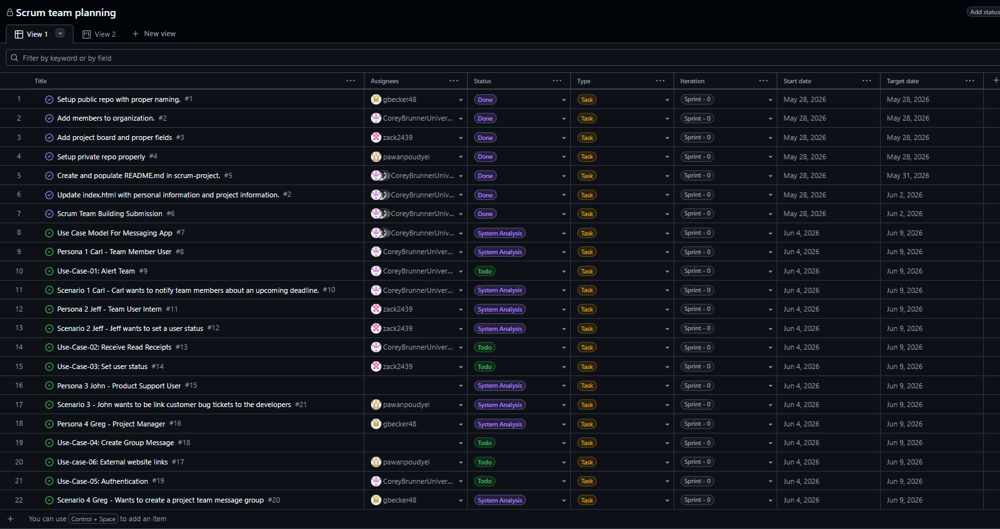
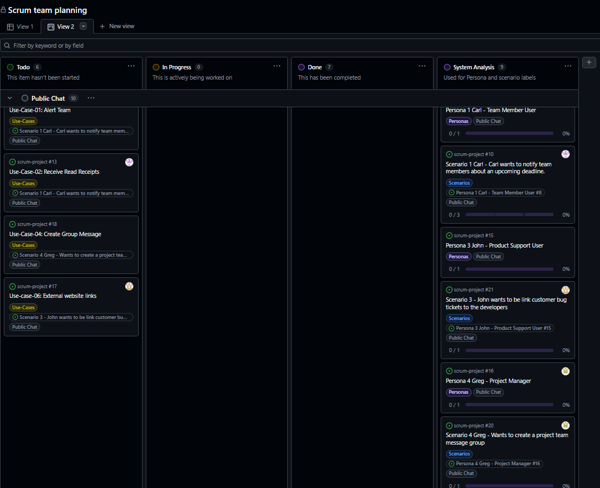
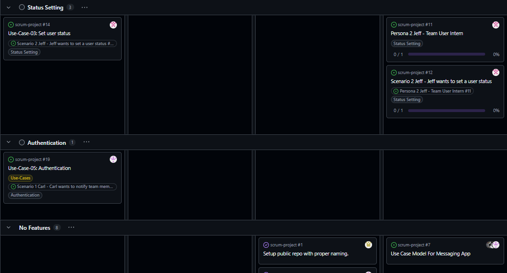

# README.md — Scrum Project Report Template

**University of Cincinnati**

**EECE/CS-3093C — Software Engineering, Summer 2026**

**Instructor:** Dr. Phu Phung

---

# Scrum Project — Messenger

> Replace **"Messenger App Project"** with the title of your team's secure web application.

## Team Members

_Teams are 3–4 students (per syllabus). Solo teams are not permitted._

1. Member 1 Corey Brunner — brunnecj@mail.uc.edu — Scrum Master
2. Member 2 Pawan Poudyel — poudyepn@mail.uc.edu — Product Owner
3. Member 3 Zackary Bailey — baileyzc@mail.uc.edu — Developer
4. Member 4 Abdulah Dia — diaah@mail.uc.edu — Developer
5. Member 5 Garrett Becker — beckergt@mail.uc.edu — Developer

---

# Project Management Information

| Item | URL |
|---|---|
| Team homepage / landing page | [https://github.com/uc-se-sm26-team1/uc-se-sm26-team1.github.io](https://github.com/uc-se-sm26-team1/uc-se-sm26-team1.github.io) |
| Live prototype (Azure App Services) | https://TODO.azurewebsites.net |
| GitHub Projects board (private) | https://github.com/orgs/uc-se-sm26-team1/projects/2/views/1 |
| Source code repository (private) | https://github.com/uc-se-sm26-team1/scrum-project |
| MongoDB Atlas cluster (configuration only — no credentials) | _e.g., cluster name, region_ |

## Revision History

| Date       | Version | Description                          | Author |
|------------|---------|--------------------------------------|--------|
| 05/28/2028 | 0.1     | Initial draft (Sprint 0) and README.md implementation             | TODO   |
| MM/DD/YYYY | 0.2     | Added use cases and architecture     | TODO   |

---

# Overview

_Start in Sprint 0; refine across all sprints._

Describe the project in 2–4 paragraphs: the problem it addresses, the target users, and a high-level summary of the proposed solution. Include a **high-level architecture diagram** 

---

# System Analysis

_Start in Sprint 0; keep updating._

## User Requirements

List the high-level functional and non-functional requirements. These will be refined into user stories and use cases. _(Main focus of Sprint 0.)_

- **FR-1:** As a user I would like the ability to set a user status to display my availability to the other users of the messenger application.
- **FR-2:** As a registered user, I want to create a new group chat by selecting multiple users and assigning a group name, so that I can coordinate and communicate with my team in a shared messaging space without needing separate individual messages.
- **NFR-1 (Performance):** The system shall detect hyperlinks within 1 second and load them under normal conditions.
- **NFR-2 (Usability):** There must be a clear confirmation prompt from the application before a user alerts a team of more than 25 members to prevent accidental pinging.
- **NFR-3 (Security — see §Security):** The system shall verify users through multi-factor authentication from email or text messages.

## User Stories & Product Backlog

https://github.com/orgs/uc-se-sm26-team1/projects/2

Include a representative screenshot of the **Todo / In Progress / Done** columns at the end of each sprint. _(Sprint 0 onward.)_

Table view of Sprint 0:



Public chat section board:



Status setting, Authentication, and No features section:




## Use Cases

[](https://editor.plantuml.com/uml/LT3FJiCm3CVnUvx2wdq7zcT7j6bNk0ps02RzqKMaQMKxW8HuTzGgICdnAtyYnJwfiLWUeujuDxA990ntepu8l8KfEVOs2NMNAILuGqytXNJ4Ikl4BOxJ447TCrIH1WYTvxcZ7qUK5PuLr9qZnEWLFAvlRvU7Udg5H_W4NS4zhJ6R5hYjuGji2I4rjlnFTZMv2DX0WqnvfX6gFA2uVVEZR7Sa2vwNFOiurE8ff8_b9FWsIE98NtZJOD22Z-wtd6UpULnNgclRrAwfVLE7fexkXDJdCVu1)

| UC ID | Use Case            | Primary Actor | Brief Description |
|-------|---------------------|---------------|-------------------|
| UC-01 | Alert Team              | Connected User          | Connected User uses the '@(tagline/username)' to alert team members; Connected User clicks 'Send' and all team members are alerted. |
| UC-02 | Receive Read Receipts                | Connected User          | The receiving user reads group message. The user that sent the message sees through the chat UI that the receiving user has read the message. |
| UC-03 | Set user status| Connected User | System allows the user to select a custom user status to display availability |
| UC-04 | Create Group Message | Connected User | Actor selects “Create Group Chat,” enters group details (such as group name and participants), and submits the request; the system validates the input, creates a new group conversation. |
| UC-05   |   Authentication |  Connected User |   The user would like to log into the messaging app. The user is prompted to enter his details. The system verifies the user's credential and decides to let the user proceed or not.|
| UC-06 | Links to external websites| Connected User| Actor pastes link in chat and it is able to be clicked on and opens in web browser|

---

# System Design

_Start in Sprint 1; keep updating._

## Architecture

Describe the architectural style (e.g., layered, client-server, microservices) and the major components. Embed an architecture diagram if it differs from the high-level one in §Overview.

[](https://editor.plantuml.com/uml/NLB1RjD04BtlLunoRXAuHWYrJP0AIg2g8t6eUvZOWxF4dZKxOvSAyU_CndQW72nxFU-zUMzchqKnQjVKJhtM13iI8QueGlzcyHPkOd7qIeLsaM0EwzeJwpAZs1jYG-8hTavEdbkCs40HcZQmGJ9zCR5eHEIg9kTQB4vO4Sm62TZY2yKP_7AFjp4yYwaDXPplzhljSfrboq_OOrP4t-eJeC28Sx__4HkD_1Nx74fQV1TOmeUVRRGiC41C5hciII26Jkrb9y2sXJfKlZZhZmJtc8NYHBhm8US7mdgklY5eh8ILv-gC7I0VloGp9IeUKCpDBd0LDhTmepLApkiwT2Linl8iyKQ4SrFe-VpznUaAxlRxUnlQZuv4JM0Ri8JMWgOyqXqQhv2wNTZl4dtoOlolT1XEjWXc6xuFd7D6AQizjWxo_PI5nBcfzNywzsZ_HXHGRsiHToadx6HWbRwmB53qefhpizUZJVbitPf-inR7rxscIQqWqs0tQsamZTvQGMUwSfNp97TrjcvvR8k2AP6uYVvwUWzajvH1iAToc9ExjkZfRly1)

## Use-Case Realization

For each use case in §Use Cases, describe how it is realized in code: which modules, endpoints, and database collections participate. **Sequence diagrams** are encouraged for non-trivial flows (e.g., authentication, message send/receive). _(Sprint 1 onward.)_

## User Interface

Embed UI mockups or screenshots and describe the interaction model. Wireframes are acceptable for Sprint 1; final screenshots for Sprint 3. _(Sprint 1 onward.)_


**Interaction Model:** The user greg is shown a basic UI with some tools and chat history on the left side. One of the tools on the left side is "Create Group". When pressed a UI pop up is shown in the middle that includes `Group Name`, `Add Users` and `Send Message (optional)`. These interactions are needed to create a group. Finally, there are buttons to create group and cancel the creation. If the group is created, the users added and the creator will see a group name pop up on the left hand side. The pop up UI will disappear and if a message was entered in that UI, then it will be sent to the group members.


**Interaction Model:** The user again is greg. The chat message includes two sections, type message and a tool bar. When a user pastes a link and wants to edit it, the user will click the `link icon`. After clicking, the user can see a UI pop up asking what the URL is and what text do they want to display the URL. After clicking `add link`, the link will be added/edited in the message box. The user can also just send raw url's to the group and it will be displayed as a link.

## Database

Describe your **MongoDB Atlas** schema: collections, fields, indexes, and relationships. Include a sample document for each collection. _(Sprint 2 onward; refine in Sprint 3.)_

```json
// Example collection: users
{
  "_id": "ObjectId",
  "username": "string (unique, indexed)",
  "passwordHash": "string (bcrypt)",
  "createdAt": "ISODate"
}
```

---

# Security (SSDLC)

Our team will apply the Secure Software Development Lifcycle (SSDLC) thoughout the design, implementation, testing, and development of the Messenger application. Security will be considered in every layer of the system like the client UI, server side application logic, real time Socket.io communication, database access, and at the final deployed application. 

A concrete security threat for Messenger is Cross-Site Scripting (XSS) at the UI layer. Since users can type and send messages, a malicious user could attempt to send HTML or JavaScript code as a message. If the application displays that message without the proper protection the code could run in another user's browser. That user's browser has no way to know that the code should not be trusted. The user's sensitive and confidential information is at risk. 

To reduce this risk, our team will sanitize message content before rendering it in the conversation view of the application. We will also consider using a Content Security Policy (CSP) to restrict which scripts are allowed to run in the browser. 

## Security Requirements

List security requirements alongside functional requirements. _(Sprint 0.)_
- **SR-1:** All communication between the client and server must use HTTPS to prevent messages and credentials from being intercepted in transit. 
- **SR-2:** User passwords must be hashed using bcrypt before being stored in the database; plaintext passwords must never be saved or logged.
- **SR-3:** All user-submitted message content must be sanitized before being displayed in the chat to prevent Cross-Site Scripting (XSS) attacks.
- **SR-4:** Users must be automatically logged out after 30 minutes of inactivity to prevent unauthorized access from unattended sessions.
- **SR-5:** Group chat creation and membership changes must be validated on the server side; clients must not be trusted to enforce access control on their own.
## Threat Model

Identify assets, trust boundaries, and threats. STRIDE or attack-tree format is acceptable. _(Sprint 0–1.)_

| Asset | Threat | Mitigation |
|-------|--------|------------|
| User credentials | Credential stuffing | Rate limiting + bcrypt |
| TODO  | TODO   | TODO       |

## Security Review Notes

Summarize findings from your Sprint 2 security review and any remediation taken. _(Sprint 2 onward.)_

---

# Implementation

_Start in Sprint 1; keep updating._

Specify your development approach, languages, frameworks, and runtime. Default stack for this course:

| Layer            | Technology                                      |
|------------------|-------------------------------------------------|
| Runtime          | Node.js (Azure Cloud Shell for development)     |
| Server framework | TODO _(e.g., Express)_                          |
| Database         | MongoDB Atlas                                   |
| Client           | HTML / CSS / JavaScript _(framework optional)_  |
| Version control  | git + GitHub (branches + pull requests + code review) |
| Project mgmt     | GitHub Projects                                 |
| Hosting          | Azure App Services                              |
| CI/CD            | GitHub Actions                                  |
| ...              | ...          |

For each sprint, add a subsection that summarizes new implementation work. Include code snippets only when they illustrate a non-trivial design decision (not as a substitute for the source code itself).

## Getting Started Locally

```bash
# Clone
git clone git@github.com:TODO/TODO.git
cd TODO

# Install dependencies
npm install

# Configure environment (copy and edit; never commit .env)
cp .env.example .env

# Run
npm start
```

## CI/CD Pipeline

Describe the GitHub Actions workflow(s) under `.github/workflows/`. _(Sprint 1 onward.)_

- **Build & test:** triggered on every push and pull request.
- **Deploy:** triggered on merge to `main`; deploys to Azure App Services.

## Deployment

Describe how to deploy and the URL of the live application. Include a note on environment variables (set in Azure App Services Configuration, never in source). _(Sprint 1 onward.)_

---

# Testing & Quality Assurance

_Start in Sprint 1; **major** focus in Sprint 3._

## Test Plan

Summarize your testing strategy across unit, integration, and system testing. _(Sprint 2 onward.)_

## Test Coverage

Report current test coverage and how to run the suite locally and in CI.

```bash
npm test
```

## QA Plan

Manual test cases for user-facing flows, with expected vs. actual results. _(Sprint 3.)_

---

# GenAI Usage & Reflection

_Start in Sprint 2; **required** in Sprint 3._

Per the course academic integrity policy, the team must document all AI-assisted work on the team project. **Sprint 3 recommends the team to use a GenAI tool** for the final prototype and to document each substantive prompt.

---

# Software Process Management

_Start in Sprint 0; keep updating._

Describe how your team applies **Scrum**: roles, ceremonies (sprint planning, daily stand-ups, review, retrospective), and tools (GitHub Projects board, GitHub Issues, pull requests).

Include:
- A screenshot of the **GitHub Projects board** (Todo / In Progress / Done) at the end of each sprint.
- A **Roadmap view** screenshot from GitHub Projects, or a timeline produced from issue milestones. _(Note: GitHub Projects has a Roadmap view rather than a true Gantt chart; a Roadmap screenshot satisfies this requirement.)_

## Scrum Process

> Copy the block below for each sprint (Sprint 0, 1, 2, 3).

### Sprint 0

**Duration:** 2026-05-27 to 2026-06-16

#### Sprint Goal
The goal of this sprint is to outline the basic requirements, scenarios, and use cases of our messenger application.

#### Completed PBIs / Tasks
1. TODO
2. TODO
3. TODO

#### Contributions

| Member | Hours | Contribution Summary |
|--------|-------|----------------------|
| Member 1 - Corey Brunner | 7 | added Use-cases 1 and 2. Added AC and and sequence diagrams for Use case 1. Futhermore, added basic messenger UI, UI diagrams for use cases 4-6, Managed project board by added comments to team members use cases, created issues, and assigned tasks.  |
| Member 2 - Zack Bailey | 6 | added use case 4 derived from the scenario involving status setting. Added pbis that were relevant to the rubric and module 3. Completed acceptance criteria and sequence diagrams for my use case. Created the sprint retrospective based upon the group consensus of the sprint.|
| Member 3 | X | TODO |
| Member 4 | X | TODO |
| Member 5 | X | TODO |

#### Sprint Retrospective

| Good | Could have been better | How to improve |
|------|------------------------|----------------|
|   Teamwork   |      Organization                  |      Communicate with team to ensure proper organization.          |
|   Coordination   |     Redundancies                   |        Establish what the needed things are in order to prevent redundancies.        |


- **What went well** — Good teamwork and team coordination. We were mostly able to figure out how to delegate tasks to each member. Our use cases were descriptive and defined the problem well. Acceptance criteria and sequence diagrams were done well and made the use cases easy to quantify.
- **What could have been better** — Our biggest struggle was organization, specifically when utilizing the project board with pbis. Making sure all pbis were properly labeled and in the correct fields was also difficult. We also had some overlapping pbis and use cases that added extra clutter but were not needed.
- **How we will improve next sprint** — Using the fact that we had good team coordination, we will work to improve the project board organization and remove any redundancies that make it unclear what we need to do. We will also make sure to communicate what pbis we are creating so we do not have duplicates.

### Sprint 1

**Duration:** YYYY-MM-DD to YYYY-MM-DD

#### Sprint Goal
TODO — one sentence.

#### Completed PBIs / Tasks
1. TODO
2. TODO
3. TODO

#### Contributions

| Member | Hours | Contribution Summary |
|--------|-------|----------------------|
| Member 1 | X | TODO |
| Member 2 | X | TODO |
| Member 3 | X | TODO |
| Member 4 | X | TODO |
| Member 5 | X | TODO |

#### Sprint Retrospective

| Good | Could have been better | How to improve |
|------|------------------------|----------------|
|      |                        |                |
|      |                        |                |


Working through the sprints is a continuous-improvement process. The retrospective happens at the end of a sprint, before planning the next one. Cover three things briefly:

- **What went well** — celebrate and reinforce.
- **What could have been better** — be specific (e.g., "we underestimated authentication" not "things were hard").
- **How we will improve next sprint** — concrete, owned actions.

### Sprint 2

**Duration:** YYYY-MM-DD to YYYY-MM-DD

#### Sprint Goal
TODO — one sentence.

#### Completed PBIs / Tasks
1. TODO
2. TODO
3. TODO

#### Contributions

| Member | Hours | Contribution Summary |
|--------|-------|----------------------|
| Member 1 | X | TODO |
| Member 2 | X | TODO |
| Member 3 | X | TODO |
| Member 4 | X | TODO |
| Member 5 | X | TODO |

#### Sprint Retrospective

| Good | Could have been better | How to improve |
|------|------------------------|----------------|
|      |                        |                |
|      |                        |                |


Working through the sprints is a continuous-improvement process. The retrospective happens at the end of a sprint, before planning the next one. Cover three things briefly:

- **What went well** — celebrate and reinforce.
- **What could have been better** — be specific (e.g., "we underestimated authentication" not "things were hard").
- **How we will improve next sprint** — concrete, owned actions.

### Sprint 3

**Duration:** YYYY-MM-DD to YYYY-MM-DD

#### Sprint Goal
TODO — one sentence.

#### Completed PBIs / Tasks
1. TODO
2. TODO
3. TODO

#### Contributions

| Member | Hours | Contribution Summary |
|--------|-------|----------------------|
| Member 1 | X | TODO |
| Member 2 | X | TODO |
| Member 3 | X | TODO |
| Member 4 | X | TODO |
| Member 5 | X | TODO |

#### Sprint Retrospective

| Good | Could have been better | How to improve |
|------|------------------------|----------------|
|      |                        |                |
|      |                        |                |


Working through the sprints is a continuous-improvement process. The retrospective happens at the end of a sprint, before planning the next one. Cover three things briefly:

- **What went well** — celebrate and reinforce.
- **What could have been better** — be specific (e.g., "we underestimated authentication" not "things were hard").
- **How we will improve next sprint** — concrete, owned actions.
Keep it under an hour. The output is bullet points in the table above and any new PBIs created on the board.

---

# User Guide / Demo

_Start in Sprint 1; finalize in Sprint 3._

Write this section as both a **demo** (with screenshots of the running application) and a **how-to** for a first-time user. Cover sign-up, login, and the main user flows.

---

# License & Code of Conduct

This project is developed for academic purposes as part of EECE/CS-3093C at the University of Cincinnati. The team follows the **ACM/IEEE Software Engineering Code of Ethics** (https://www.acm.org/code-of-ethics).

If your team chooses to publish the repository after the course, add an explicit license (e.g., MIT) here and a `LICENSE` file at the repo root.

---

_End of template. Last template revision: TODO: YYYY-MM-DD._
