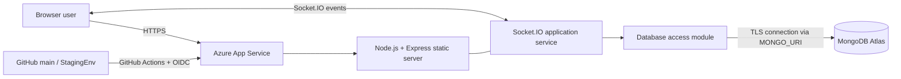
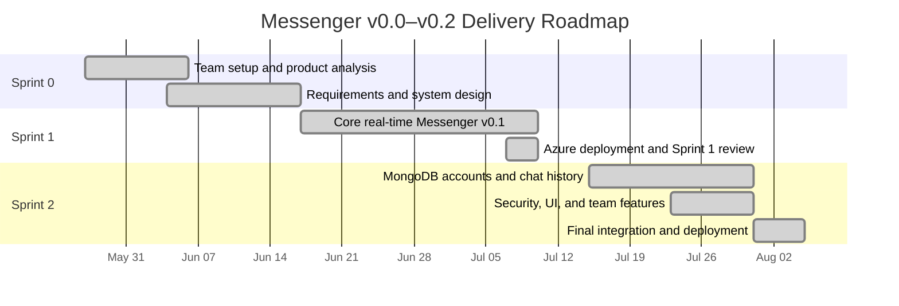
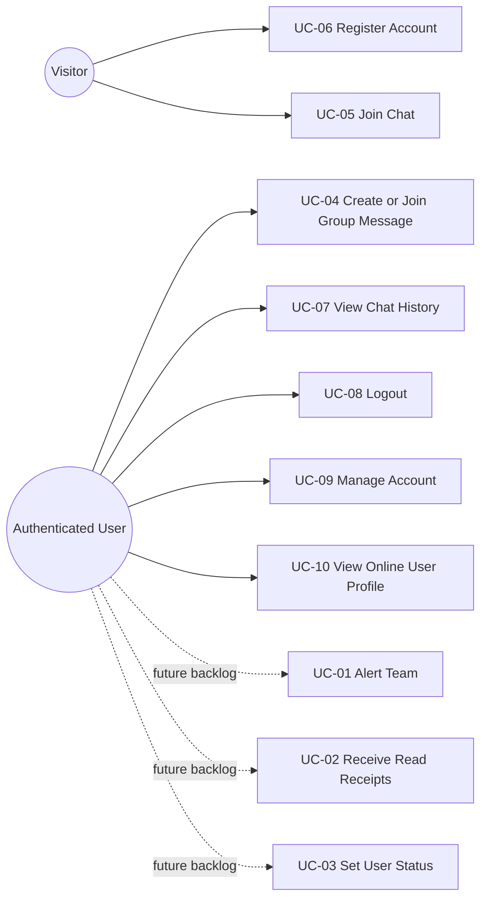
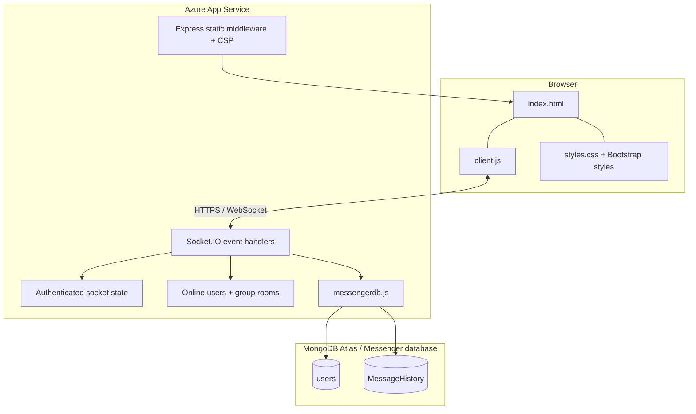
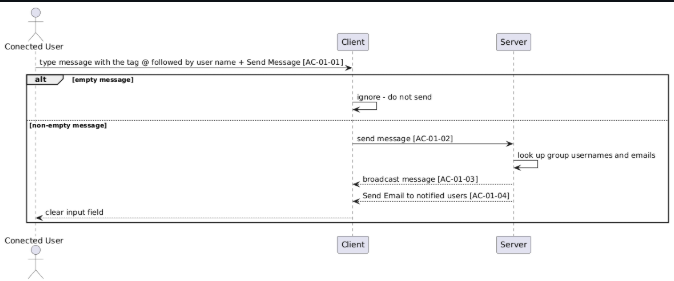
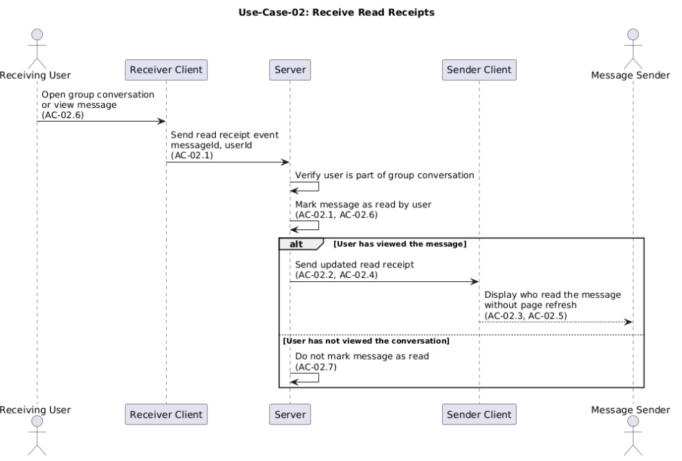
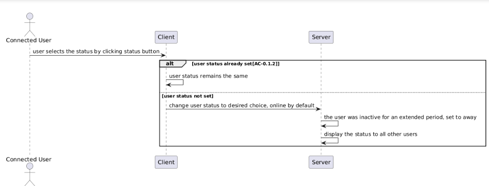
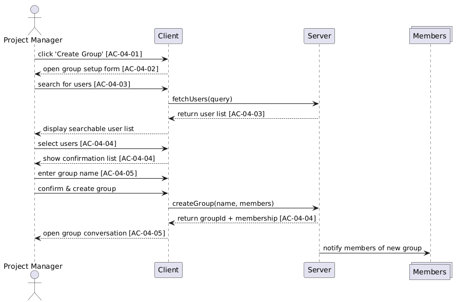
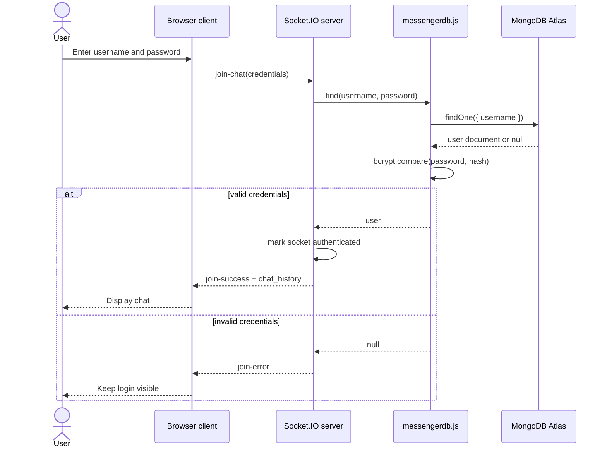
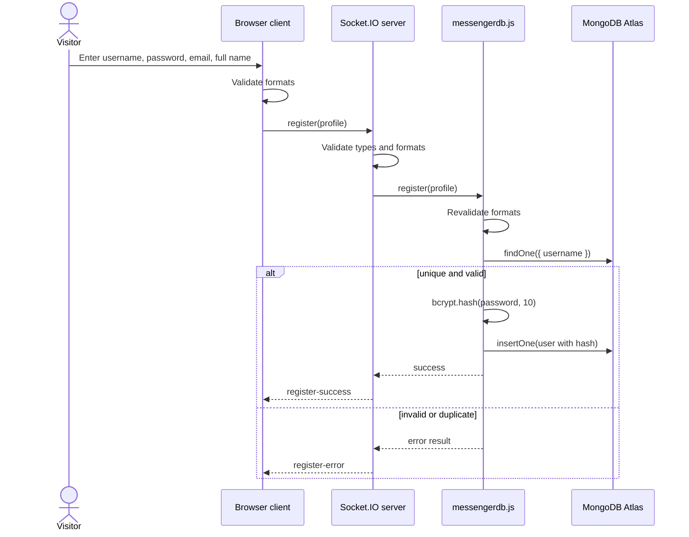

# Messenger v0.2 — Final Scrum Project Report

**University of Cincinnati**

**EECE/CS-3093C — Software Engineering, Summer 2026**

**Instructor:** Dr. Phu Phung

**Team:** UC Software Engineering Summer 2026, Team 1

## Team Members

| Member | University email | Scrum role |
| --- | --- | --- |
| Corey Brunner | brunnecj@mail.uc.edu | Scrum Master |
| Pawan Poudyel | poudyepn@mail.uc.edu | Product Owner |
| Zackary Bailey | baileyzc@mail.uc.edu | Developer |
| Abdulah Dia | diaah@mail.uc.edu | Developer |
| Garrett Becker | beckergt@mail.uc.edu | Developer |

---

# Project Management Information

| Item | Link or configuration |
| --- | --- |
| Team homepage | [https://uc-se-sm26-team1.github.io/](https://uc-se-sm26-team1.github.io/) |
| Team homepage repository | [uc-se-sm26-team1.github.io](https://github.com/uc-se-sm26-team1/uc-se-sm26-team1.github.io) |
| Live Messenger v0.2 prototype | [Azure App Service](https://team1-messengerapp-c4h5h4haaqgbhaef.canadacentral-01.azurewebsites.net/) |
| GitHub Projects board | [Team 1 Scrum project](https://github.com/orgs/uc-se-sm26-team1/projects/2/views/1) |
| Private source repository | [uc-se-sm26-team1/scrum-project](https://github.com/uc-se-sm26-team1/scrum-project) |
| MongoDB Atlas | `Team10Messenger` cluster, Atlas free tier; credentials are supplied only through `MONGO_URI` |

The team homepage and live Azure URL returned HTTP 200 during the documentation audit on August 4, 2026. The Azure response also included the application's Content Security Policy header.

## Revision History

| Date | Version | Description | Author |
| --- | --- | --- | --- |
| 2026-05-28 | 0.0 | Created the repository, team information, links, and initial report structure | Team 1 |
| 2026-06-17 | 0.0 | Completed Sprint 0 requirements, use cases, threat model, architecture, and retrospective | Team 1 |
| 2026-07-09 | 0.1 | Documented the first working public/private real-time chat prototype and Azure pipeline | Team 1 |
| 2026-07-30 | 0.2 | Added database-backed accounts, chat history, profile management, logout, group chat, and message deletion | Team 1 |
| 2026-08-04 | 0.2 | Audited the report against the final rubric and synchronized it with the implemented source | Team 1, AI-assisted |

---

# Overview

Messenger is a real-time web application for students, faculty, and project teams that need one browser-based space for public, private, and group communication. It reduces the need to switch between incompatible desktop applications and gives connected users immediate messages, typing indicators, online-presence information, clickable links, and access to public chat history.

Version 0.2 replaces Sprint 1's username-only entry with accounts stored in MongoDB Atlas. A visitor can register with a username, password, email address, and full name; authenticate with a username and password; update profile information; and log out. Passwords are hashed with bcrypt before storage. Public messages are persisted and restored after login, and a sender can soft-delete their own public message. The final client also includes private messaging, name-based group rooms, public profiles for online users, and separate public/private/group panels.

The application uses a client-server architecture. Azure App Service hosts a Node.js/Express application that serves the single-page HTML/CSS/JavaScript client. Socket.IO carries authentication and real-time events. A dedicated database module reads and writes users and public message history in MongoDB Atlas. GitHub Actions builds an artifact and deploys approved branch changes to staging or production.



---

# System Analysis

## Sprint Evolution

**Sprint 0 — analysis and design.** The team established personas and scenarios, selected a browser-based Messenger product, created the initial use cases and acceptance criteria, modeled security threats, and produced architecture and interface designs.

**Sprint 1 — Messenger v0.1.** The team implemented separate login and chat views, username-based entry, public and private real-time messaging, a live online-user list, separate public/private panels, typing indicators, automatic scrolling, link insertion, and automatic conversion of HTTP(S) URLs. The prototype ran on Node.js and Socket.IO and was deployed through GitHub Actions to Azure App Service.

**Sprint 2 — Messenger v0.2.** The team connected the server to MongoDB Atlas and replaced username-only entry with registration and password authentication. Sprint 2 also introduced bcrypt password hashes, multi-layer registration validation, authenticated Socket.IO operations, logout, account editing, public chat persistence, owner-only soft deletion, online-user profiles, name-based group rooms, a redesigned Bootstrap-based login/registration interface, staging deployment, CSP response headers, and environment-based secret configuration.

## User Requirements

### Required Functional Requirements and Traceability

| ID | Final requirement | v0.2 realization and evidence |
| --- | --- | --- |
| F1.1 | Login and chat UIs are visually and functionally separated. | `#loginUI`, `#registerUI`, and `#chatUI` are separate sections in [`index.html`](src/ui/index.html); only the appropriate view is shown. |
| F1.2 | A v0.1 user can enter with a username and no password. | Delivered in Sprint 1 and intentionally superseded by the password requirement in F2.1 for v0.2. |
| F1.3 | Only logged-in users can access the chat interface. | The client reveals the chat only after `join-success`; the server independently applies `authorizeUser()` to protected events. |
| F1.4 | Logged-in users can send and receive public messages in real time. | Socket.IO `message` events persist through `storePublicChat()` and broadcast to authenticated sockets. |
| F1.5 | Logged-in users can send and receive private messages with a specific online user. | `private-message` validates a recipient, locates that user's socket, and sends only to the recipient and sender. |
| F1.6 | An online-user list is displayed and updated in real time. | The server maintains a socket-to-username map and emits `user-list` after login, logout, and disconnect. |
| F1.7 | Public and private chat are visually distinct. | The client has separate labeled public, private, and group panels and separate response areas. |
| F1.8 | Public and private typing indicators update in real time. | `public-typing`, `public-stop-typing`, `private-typing`, and `private-stop-typing` events update dedicated UI elements. |
| F1.9 | Team feature for v0.1: external website links. | HTTP(S) text is linkified after paste or a 500 ms typing delay; an insert-link dialog supports custom display text. |
| F2.1 | Users authenticate with a database-backed username and password; invalid credentials fail. | `join-chat` calls `messengerdb.find()`, which looks up the username and uses `bcrypt.compare()` against the stored hash. |
| F2.2 | Anyone can register with username/password and additional profile fields. | `register` collects username, password, email, and full name, validates them at three layers, hashes the password, and inserts a user document. |
| F2.3 | Only logged-in users can send or receive application messages. | Protected server events call `authorizeUser()` and broadcasts use `sendToAuthenticatedClients()`. |
| F2.4 | A logged-in user can log out. | `logout` clears authentication, removes the user from groups and the online list, then returns the browser to the login UI. |
| F2.5 | A logged-in user can edit their profile, including password. | `edit-profile` requires the current password and can update the bcrypt password hash, email, and full name. |
| F2.6 | Messages are stored in the database and history is visible after login. | The latest 100 public messages are stored in `MessageHistory`, sorted by timestamp, and emitted as `chat_history`. Private and group history is not persisted in v0.2. |
| F2.7 | Team feature for v0.2: delete an owned public message. | A sender can select `x`; the data layer verifies ownership and soft-deletes the message by replacing its content and setting `deleted: true`. The server should be hardened so it broadcasts `message-delete` only after a successful owner-authorized update. |
| F2.SEC | Password hashing is verifiable in the database. | Registration and password changes call `bcrypt.hash(value, 10)`; login calls `bcrypt.compare()`. Plaintext passwords are not written to MongoDB. |

### Non-Functional Requirements

| ID | Category | Requirement | Evidence/status |
| --- | --- | --- | --- |
| NFR-1 | Performance | Pasted links shall be recognized immediately and typed links within one second under normal conditions. | Client linkification uses a 0 ms paste delay and 500 ms typing delay. |
| NFR-2 | Usability | Login, registration, public chat, private chat, group chat, profile editing, and logout shall be clearly labeled. | Separate sections, panel headings, action buttons, inline validation, and success/error messages are present. |
| NFR-3 | Security | Credentials shall use HTTPS in production and passwords shall never be persisted in plaintext. | The production URL uses HTTPS; bcrypt hashing and environment-based MongoDB credentials are implemented. |
| NFR-4 | Data availability | A newly authenticated user shall receive recent public history without manually refreshing. | The server loads up to 100 messages at successful login. |
| NFR-5 | Maintainability | Secrets and environment-specific configuration shall remain outside version-controlled source. | `.env` is ignored, `.env.example` documents `MONGO_URI`, and Azure configuration supplies the production value. |

## User Stories and Product Backlog

The authoritative backlog is the private [GitHub Projects board](https://github.com/orgs/uc-se-sm26-team1/projects/2/views/1). Issues contain the user stories, acceptance-criteria codes, assignees, iteration dates, and progress state. The captures below preserve the board state for each sprint.

### Sprint 0 Board


### Sprint 1 Board


### Sprint 2 Board


### Delivery Roadmap



## Use Cases

The following diagram and table distinguish implemented v0.2 behavior from future product-backlog ideas. This prevents the final design from implying that planned Sprint 0 features are already present.



| UC ID | Verb-noun use case | Primary actor | Final description | Status |
| --- | --- | --- | --- | --- |
| UC-01 | Alert Team | Authenticated user | Mention a team or user and notify the affected members. | Designed; future backlog |
| UC-02 | Receive Read Receipts | Authenticated user | See whether recipients have read a group message. | Designed; future backlog |
| UC-03 | Set User Status | Authenticated user | Select and publish an availability status. | Designed; future backlog |
| UC-04 | Create or Join Group Message | Authenticated user | Enter a group name, join its Socket.IO room, and exchange messages with members of that room. | Implemented with name-based membership |
| UC-05 | Join Chat | Registered user | Submit a username/password; enter chat only when MongoDB lookup and bcrypt comparison succeed. | Implemented |
| UC-06 | Register Account | Visitor | Create an account with a unique username, password, email, and full name. | Implemented |
| UC-07 | View Chat History | Authenticated user | Automatically view the most recent persisted public messages after login. | Implemented |
| UC-08 | Logout | Authenticated user | End the authenticated socket state, leave the active group, and return to login. | Implemented |
| UC-09 | Manage Account | Authenticated user | Verify the current password and update password, email, and/or full name. | Implemented |
| UC-10 | View Online User Profile | Authenticated user | Select an online user and view the user's projected username, full name, and email. | Implemented |

External link insertion is the implemented F1.9 feature and retains its original Sprint 1 sequence diagram under System Design.

---

# System Design

## Architecture

Messenger v0.2 follows a layered client-server design:

1. **Presentation layer:** [`ui/index.html`](src/ui/index.html), [`ui/styles.css`](src/ui/styles.css), and [`ui/client.js`](src/ui/client.js) implement the single-page interface, local validation, view switching, and Socket.IO client events.
2. **Application layer:** [`server.js`](src/server.js) serves static assets, sets CSP, manages socket authentication and online/group state, validates event data, and coordinates real-time behavior.
3. **Data-access layer:** [`Database Files/messengerdb.js`](src/Database%20Files/messengerdb.js) owns MongoDB queries, bcrypt operations, data-layer validation, history persistence, profile updates, and soft deletion.
4. **Data layer:** MongoDB Atlas stores `users` and `MessageHistory`; in-memory maps hold only current socket and group membership state.
5. **Delivery layer:** GitHub Actions builds from `main` or `StagingEnv`, transfers a deployment artifact, authenticates to Azure through OIDC, and deploys to the corresponding App Service.



## Use-Case Realization

| Use case/feature | Client interaction | Server events/modules | Data or state |
| --- | --- | --- | --- |
| UC-01 Alert Team | Planned mention UI | Not present in v0.2 | Future backlog |
| UC-02 Read Receipts | Planned read indicator | Not present in v0.2 | Future backlog |
| UC-03 Set Status | Planned availability selector | Not present in v0.2 | Future backlog |
| UC-04 Group Message | Group name, join/leave, group composer | `join-group`, `leave-group`, `group-message`; Socket.IO rooms | In-memory `groups` map; not persistent |
| UC-05 Join Chat | Login form | `join-chat`, `authorizeUser()`, `messengerdb.find()` | `users`; authenticated socket flag |
| UC-06 Register | Registration form and local validation | `register`, `messengerdb.register()` | New `users` document with bcrypt hash |
| UC-07 Chat History | Public response pane | `loadChatHistory()`, `chat_history` | Latest 100 `MessageHistory` documents |
| UC-08 Logout | Logout button and view reset | `logout`, group cleanup, user-list broadcast | Auth flag and in-memory presence removed |
| UC-09 Manage Account | Account Management form | `edit-profile`, `messengerdb.editProfile()` | Selected fields updated in `users` |
| UC-10 View Profile | Select an online username | `get-user-profile`, `getPublicProfile()` | Projected public fields from `users` |
| F1.9 External Links | Link dialog or automatic URL conversion | Existing public/private message events | HTTP(S)-only anchors in message HTML |
| F2.7 Delete Message | Sender selects the `x` button | `delete-message`, `messengerdb.deleteMsg()` | Owner-checked soft delete in `MessageHistory` |

### Sequence Diagrams

The Sprint 0 diagrams below document the planned flows for UC-01 through UC-04. The realization table marks the first three as future backlog so the design remains consistent with v0.2.









UC-05 authentication is realized by the following final flow:



UC-06 registration uses client, server, and data-layer validation:




## User Interface

The v0.2 client is a single-page application with three unauthenticated/authenticated states: login, registration, and chat. A successful login hides the authentication views and displays a sidebar plus separate public, private, and group panels. Account Management temporarily replaces the chat view. Selecting an online username opens a read-only profile dialog.

The following Sprint 0 mockups established the interaction concepts later implemented in the application:


The final v0.2 group implementation uses a shared group name instead of the mockup's invitation list. Every intended member enters the same group name and selects **Join Group**.


The final link interface supports both the popup shown in the mockup and automatic HTTP(S) URL conversion in public and private composers.

## Database

Database name: `Messenger`. The data-access module uses two collections.

### `users`

| Field | Type | Meaning |
| --- | --- | --- |
| `_id` | ObjectId | MongoDB document identifier |
| `username` | String | Login identifier, 3–20 letters/numbers/underscores |
| `password` | String | bcrypt hash generated with cost factor 10 |
| `email` | String | Validated profile email |
| `fullName` | String | Display/contact name |

```json
{
  "_id": "ObjectId('...')",
  "username": "student_1",
  "password": "$2b$10$<bcrypt-hash>",
  "email": "student1@example.edu",
  "fullName": "Student One"
}
```

### `MessageHistory`

| Field | Type | Meaning |
| --- | --- | --- |
| `_id` | ObjectId | MongoDB document identifier |
| `sender` | String | Username captured from the authenticated socket |
| `message` | String | Public message HTML/text |
| `timestamp` | Number | Milliseconds since the Unix epoch |
| `deleted` | Boolean | Whether the sender soft-deleted the message |

```json
{
  "_id": "ObjectId('...')",
  "sender": "student_1",
  "message": "Project meeting at 3:00 PM",
  "timestamp": 1785524400000,
  "deleted": false
}
```

There is no stored foreign key: `MessageHistory.sender` logically references `users.username`. The current source creates no custom indexes, so only MongoDB's default `_id` indexes are guaranteed by code. Production hardening should add a unique index on `users.username` to make duplicate-account prevention atomic and a descending index on `MessageHistory.timestamp` to support the history query. Private and group messages are currently transient.

---

# Security (SSDLC)

Security is applied at the client, Socket.IO server, data-access module, deployment configuration, and database boundary. The Sprint 2 implementation introduced hashed passwords, repeated input validation, authenticated socket checks, field-limited updates/projections, a CSP response header, HTTPS deployment, and environment-based secret storage. The security review also records residual risk rather than treating the current controls as complete.

## Security Requirements

| ID | Requirement | Implementation/status |
| --- | --- | --- |
| SR-1 | Production client/server traffic shall use HTTPS. | The documented Azure endpoint uses HTTPS. |
| SR-2 | Passwords shall be hashed before storage and never logged. | `bcrypt.hash(..., 10)` stores hashes; login uses `bcrypt.compare()`; debug logs omit passwords. |
| SR-3 | Registration and profile inputs shall be validated at every layer that consumes them. | Username/password/email/full-name checks exist in the browser, server, and database module; profile changes require current-password verification. |
| SR-4 | MongoDB selectors shall be built from validated primitive values, not client-provided query objects. | Login rejects non-string credentials; registration uses regex checks; profile updates use a server-derived username and an allowlisted update object. |
| SR-5 | Protected chat/profile operations shall require an authenticated socket. | `authorizeUser()` guards message, group, typing, profile, edit, and logout flows; broadcasts target authenticated sockets. |
| SR-6 | The browser shall receive a restrictive Content Security Policy. | Express sets `default-src 'self'` and explicit script, style, connection, and font source allowlists. The live response was verified on August 4, 2026. |
| SR-7 | Database credentials shall not be committed in source. | `MONGO_URI` is loaded from `.env` locally and Azure configuration in production; `.env` is ignored. |
| SR-8 | User-generated message markup shall be sanitized before DOM insertion. | **Open risk:** v0.2 still transports composer HTML and inserts it with `innerHTML`; DOMPurify or equivalent sanitization is not present. CSP reduces exploitability but is not a sanitizer. |

## Defense-in-Depth Validation

### Registration

| Layer | Checks |
| --- | --- |
| Client | Username length/pattern, password letter-and-number rule, email format, non-empty full name |
| Server | Payload presence and primitive types, trimmed values, repeated username/password/email formats |
| Data access | Repeats formats, checks for an existing username, hashes the password, inserts only named fields |
| Database | Stores the bcrypt hash rather than the submitted plaintext password |

### Profile Update

| Layer | Checks |
| --- | --- |
| Client | Requires current password and at least one proposed change |
| Server | Requires authenticated socket and a string current password; derives username from authenticated state |
| Data access | Compares current password hash, validates new password/email, constructs an allowlisted `$set` object, and re-hashes changed passwords |
| Database | Updates only the authenticated user's document |

## Threat Model

### Assets

- Password hashes and account/profile data
- Public chat history and message ownership
- Private and group message confidentiality while connected
- Authenticated socket state, online-user list, and group membership
- MongoDB connection credentials and Azure deployment configuration
- Application availability and integrity

### Trust Boundaries

1. User input crossing into the browser DOM and Socket.IO client.
2. Socket.IO data crossing from an untrusted browser to the Node.js server.
3. Validated application data crossing from the server into MongoDB Atlas.
4. Deployment artifacts and OIDC credentials crossing from GitHub Actions into Azure.
5. HTTP(S) links navigating from Messenger to external websites.

| STRIDE category | Threat | Current control | Residual risk/action |
| --- | --- | --- | --- |
| Spoofing | Invalid user attempts to impersonate an account. | MongoDB username lookup plus bcrypt comparison; generic login failure. | No login rate limiting or account lockout; credential stuffing remains possible. |
| Tampering / XSS | A message contains executable markup. | CSP has no `unsafe-inline` script permission and restricts script sources. | Raw message HTML reaches `innerHTML`; add DOMPurify on send/render and server-side content validation. |
| Repudiation | Sender denies posting or deleting a message. | Public records retain sender, timestamp, and a deletion flag. | No immutable audit log; deletion timestamp is not recorded. |
| Information disclosure | Credentials or database secrets are exposed. | HTTPS URL, bcrypt hashes, `.env`/Azure configuration, password-free logs. | Previously committed Atlas credentials remain in history and must be rotated. |
| Information disclosure | Profile email is disclosed more broadly than intended. | Server returns only username, email, and full name and only for online users to authenticated users. | Confirm that email visibility matches the privacy requirement. |
| Denial of service | Flooded login, registration, or message events consume resources. | Basic empty/type/format validation. | No event rate limiter or message-size limits are implemented. |
| Elevation of privilege | An unauthenticated socket sends protected events. | `authorizeUser()` and authenticated-only broadcasts. | Add the same explicit authorization/type guard to `delete-message`, and emit `message-delete` only when the ownership-checked update succeeds. |
| NoSQL injection | Client supplies MongoDB operators instead of strings. | Primitive type checks, regex validation, server-derived usernames, and allowlisted updates. | Continue validating every new database-bound field; add tests for object/array payloads. |
| Supply-chain compromise | A third-party browser script is altered. | jQuery, Popper, and Bootstrap scripts use Subresource Integrity and CSP source restrictions. | Pin and review dependencies regularly; reduce allowed origins when possible. |

## Sprint 2 Security Review Notes

The review found that a MongoDB Atlas connection string had previously been hardcoded in source. Sprint 2 moved the value into `process.env.MONGO_URI`, added `.env.example`, relied on the existing `.gitignore` rules for `.env`, and configured the variable in Azure App Service. Because a secret remains recoverable from Git history after removal, the associated Atlas database password should be rotated and the old credential disabled.

The review confirmed bcrypt hashing, database-backed password comparison, registration/profile validation at multiple layers, authenticated event checks, CSP delivery, and basic NoSQL injection guards. It also confirmed that the earlier XSS concern is not fully remediated: public and private message paths still use `innerHTML` without DOMPurify. CSP is useful defense in depth, but output sanitization remains required. The delete event also needs an explicit authorization/type check and a success-only broadcast. Rate limiting, message-size limits, automated security tests, and a unique username index are additional hardening items.

---

# Implementation

## Technology Stack

| Layer | Technology |
| --- | --- |
| Runtime | Node.js 18 or newer locally; GitHub Actions currently selects Node.js 24.x |
| Web server | Express 4.22 |
| Real-time communication | Socket.IO 4.8 |
| Database | MongoDB Atlas through MongoDB Node.js driver 7.5 |
| Password hashing | bcrypt 6.0, cost factor 10 |
| Configuration | dotenv 17.4 locally; Azure App Service environment variables in production |
| Client | HTML5, CSS, JavaScript, Bootstrap 5, jQuery, Font Awesome |
| Version control | Git and private GitHub repository with branches and pull requests |
| Project management | GitHub Issues and GitHub Projects |
| Hosting | Azure App Service production and staging applications |
| CI/CD | GitHub Actions, artifact transfer, Azure OIDC login, `azure/webapps-deploy` |

## Project Layout

```text
sprint2/
├── README.md
├── docs/                         diagrams and board captures
└── src/
    ├── server.js                 Express, CSP, Socket.IO application logic
    ├── Database Files/
    │   └── messengerdb.js        MongoDB and bcrypt data-access functions
    ├── ui/
    │   ├── index.html            single-page UI
    │   ├── client.js             browser events and rendering
    │   └── styles.css            application styling
    ├── .env.example              safe configuration template
    ├── package.json
    └── package-lock.json
```

## Implementation by Sprint

### Sprint 0

- Created personas, scenarios, use cases, acceptance criteria, sequence diagrams, wireframes, architecture, security requirements, and threat model.
- Established the organization, private source repository, public team homepage, GitHub Project, and initial application skeleton.

### Sprint 1 — v0.1

- Built public and private Socket.IO messaging and the online-user list.
- Separated login, public, and private interfaces; added automatic scroll and typing status.
- Added link insertion and automatic HTTP(S) link conversion.
- Added Azure production deployment through GitHub Actions.

### Sprint 2 — v0.2

- Replaced username-only entry with MongoDB-backed registration and bcrypt authentication.
- Added email/full-name profile data, password/profile editing, logout, public history loading, and owner-only soft deletion.
- Added online-user profile viewing and name-based group rooms.
- Added Bootstrap authentication views and cleaned up public/private/group chat panels.
- Added CSP, environment-based MongoDB configuration, staging deployment, and defense-in-depth validation.

## Getting Started Locally

Prerequisites: Git, Node.js 18 or newer, npm, and a MongoDB Atlas connection string with access to the `Messenger` database.

```bash
git clone git@github.com:uc-se-sm26-team1/scrum-project.git
cd scrum-project/sprint2/src
npm install
cp .env.example .env
```

On Windows PowerShell, use `Copy-Item .env.example .env` instead of `cp` if preferred. Set the local file to:

```dotenv
MONGO_URI=mongodb+srv://<database-user>:<password>@<cluster-host>/
```

Do not commit `.env`. Then start the app:

```bash
npm start
```

Open [http://localhost:8080](http://localhost:8080). The server uses `PORT` when supplied by Azure and otherwise defaults to `8080`. Startup intentionally fails if the MongoDB connection cannot be established.

## CI/CD Pipeline

The production workflow is [`.github/workflows/main_team1-messengerapp.yml`](../.github/workflows/main_team1-messengerapp.yml). A push to `main`, or a manual dispatch, performs the following:

1. Check out the repository on Ubuntu.
2. Select Node.js 24.x.
3. Run `npm install`, an optional build script, and an optional test script in `sprint2/src`.
4. Upload `sprint2/src` as the `node-app` artifact.
5. Download the artifact in a separate deployment job.
6. Authenticate to Azure using repository secrets and OIDC.
7. Deploy the artifact to the `Team1-MessengerApp` production slot.

The staging workflow is [`.github/workflows/stagingenv_team1-messengerapp-staging.yml`](../.github/workflows/stagingenv_team1-messengerapp-staging.yml) and follows the same process for pushes to `StagingEnv`, deploying to `Team1-MessengerApp-Staging`. The workflow does not currently trigger on pull requests. The package has no build or automated-test script, so the `--if-present` commands currently skip those phases.

## Deployment

Production: [Messenger v0.2 on Azure App Service](https://team1-messengerapp-c4h5h4haaqgbhaef.canadacentral-01.azurewebsites.net/).

Deployment configuration must provide `MONGO_URI` in **Azure App Service → Configuration → Application settings**. Database credentials must never be placed in `server.js`, `messengerdb.js`, a workflow file, or any committed `.env` file. Pushing an approved change to `main` triggers production deployment; `workflow_dispatch` supports a manual redeploy from GitHub Actions.

---

# Testing and Quality Assurance

## Test Strategy

The current repository relies on source review and manual functional testing across two or more browser sessions. Unit tests should isolate validation/database functions, integration tests should exercise Socket.IO events with a test database, and end-to-end tests should cover registration through logout on staging before production deployment.

On August 4, 2026, `node --check` completed successfully for `server.js`, `ui/client.js`, and `Database Files/messengerdb.js`. `npm run test --if-present` also exited successfully, but it ran no tests because `package.json` has no `test` script. Consequently, numeric code coverage is not available and the CI test phase should not be interpreted as automated verification.

## Manual QA Matrix

| Test | Expected result | Current evidence/result |
| --- | --- | --- |
| Open production URL | Login UI loads over HTTPS; chat is hidden. | HTTP 200 verified; UI separation confirmed by source audit. |
| Submit invalid credentials | Login remains visible and shows a generic error. | Implemented in `join-chat`; live account test remains part of the final demo check. |
| Register a valid unique account | Password is hashed, account is stored, and new credentials can log in. | Client/server/data flow and bcrypt call confirmed by source audit. |
| Submit malformed registration or object payloads | Request is rejected without a database operator reaching a query. | Repeated format/type guards confirmed by source audit. |
| Send a public message between two logged-in browsers | Both receive it immediately; it is stored and returns after relogin. | Socket broadcast and `MessageHistory` insert/load path confirmed by source audit. |
| Send a private message | Only sender and selected online recipient receive it. | Target-socket routing confirmed by source audit. |
| Join the same group from two browsers | Both receive room messages; nonmembers do not. | Socket.IO room membership and room-only emit confirmed by source audit. |
| Edit profile with the correct current password | Selected fields update; a new password is re-hashed. | Current-password comparison and allowlisted update confirmed by source audit. |
| Delete an owned public message | Content becomes “This message was deleted”; another username cannot delete or spoof its deletion. | Database ownership comparison exists, but the server currently broadcasts a delete event even when no owner update occurred; hardening and a two-user live test are required. |
| Log out | User leaves group/list, protected UI is cleared, and login returns. | Logout cleanup confirmed by source audit. |
| Inspect response headers | CSP header is present. | Verified on live Azure response, August 4, 2026. |
| Send hostile HTML/XSS payload | Payload should display safely without executing or modifying the DOM. | **Not fully satisfied:** CSP is present, but message HTML is not sanitized before `innerHTML`. |

## Coverage and Next Test Priorities

Current automated coverage: **not measured**. Highest-priority additions are registration/login unit tests, bcrypt hash assertions, object/array NoSQL-injection cases, authorization tests for every socket event, message ownership tests, DOMPurify/XSS regression cases, rate-limit tests, and an end-to-end staging smoke test integrated into the workflow.

---

# GenAI Usage and Reflection

The team used OpenAI Codex on August 4, 2026 for a documentation-focused audit. The substantive prompt asked Codex to update the Sprint 2 README using the final submission requirements, address Sprint 1 feedback, and inspect other repository files for implementation evidence.

| Item | Reflection |
| --- | --- |
| Output accepted | Organization of the final report, requirement-to-code traceability, architecture/data descriptions, security review, implementation/CI documentation, QA matrix, and first-time-user instructions. |
| Output modified or reviewed | Team-specific dates, roles, contribution hours, issue status, deployment details, screenshots, demo links, and any statement that depends on private GitHub/Azure/MongoDB state require human verification. |
| Output rejected | Unsupported claims that DOMPurify, rate limiting, automated coverage, private/group history persistence, or a code-created unique username index already exist. No generated application source code was accepted in this documentation task. |
| Quality impact | The audit made the report consistent with v0.2 source and replaced template placeholders with traceable evidence. |
| Security impact | The audit identified the difference between CSP defense in depth and actual message sanitization, recorded the historical credential exposure, and exposed missing rate limits/tests rather than masking them. |
| Productivity impact | Repository-wide source, workflow, asset, and commit review was condensed into a structured final report; the team remains responsible for validating every claim and live flow before submission. |

This GenAI assistance did not replace team authorship, testing, or code review. Team members must review the report and retain responsibility for the submitted work.

---

# Software Process Management

## Scrum Process

The team used GitHub Issues as PBIs and GitHub Projects as the shared backlog. Sprint planning selected issues and assigned owners; members moved work from Todo to In Progress to Done and documented progress in issue comments. Development occurred on feature or staging branches, then moved through pull requests and merges. Each sprint concluded with a review/demo, contribution summary, and retrospective. The Scrum Master coordinated ceremonies and board hygiene, while the Product Owner prioritized requirements and acceptance criteria.

## Sprint 0

**Duration:** May 27–June 16, 2026

**Sprint goal:** Define the Messenger problem, users, requirements, use cases, security concerns, architecture, and team delivery process.

### Completed PBIs and Tasks

1. Established the organization, repositories, team homepage, roles, and GitHub Project.
2. Created personas, scenarios, user stories, use cases, and acceptance criteria.
3. Created sequence diagrams and UI mockups.
4. Documented architecture, security requirements, trust boundaries, and STRIDE threats.
5. Added the initial Messenger HTML and completed the sprint review/retrospective.

### Contributions

| Member | Hours | Contribution summary and commit evidence |
| --- | ---: | --- |
| Corey Brunner | 7 | Added UC-01/UC-02, acceptance criteria, diagrams, UI designs, basic UI, and board coordination. [Representative commit `8a27eed`](https://github.com/uc-se-sm26-team1/scrum-project/commit/8a27eed) |
| Pawan Poudyel | 6 | Added the external-links use case, NFR, threat model content, diagram references, and user-story subissues. [Representative commit `06b133b`](https://github.com/uc-se-sm26-team1/scrum-project/commit/06b133b) |
| Zackary Bailey | 6 | Added the status use case, PBIs, acceptance criteria, sequence diagram, and retrospective. [Representative commit `e4aa797`](https://github.com/uc-se-sm26-team1/scrum-project/commit/e4aa797) |
| Abdulah Dia | 6 | Added the architecture diagram, SSDLC text, user story, and sequence-diagram work. [Representative commit `917352f`](https://github.com/uc-se-sm26-team1/scrum-project/commit/917352f) |
| Garrett Becker | 6 | Added the group-message use case, acceptance criteria, security requirements, and board updates. [Representative commit `8ee09f6`](https://github.com/uc-se-sm26-team1/scrum-project/commit/8ee09f6) |

### Sprint Retrospective

| Went well | Could improve | Sprint 1 action |
| --- | --- | --- |
| Team coordination and use-case definition | Project-board organization | Communicate issue ownership and required fields before work begins. |
| Acceptance criteria and diagrams | Duplicate/overlapping PBIs | Review new PBIs against existing items before adding them. |

## Sprint 1

**Duration:** June 17–July 9, 2026

**Sprint goal:** Deliver and deploy Messenger v0.1 with separated login/chat views, live public/private messaging, presence, typing indicators, and external links.

### Completed PBIs and Tasks

1. [Change the composer to a contenteditable element for links (#38)](https://github.com/uc-se-sm26-team1/scrum-project/issues/38)
2. [Automatically convert pasted/typed URLs (#30)](https://github.com/uc-se-sm26-team1/scrum-project/issues/30)
3. [Add a link-insertion button (#31)](https://github.com/uc-se-sm26-team1/scrum-project/issues/31)
4. [Visually separate public and private chat, F1.7 (#43)](https://github.com/uc-se-sm26-team1/scrum-project/issues/43)
5. [Add public/private typing status, F1.8 (#44)](https://github.com/uc-se-sm26-team1/scrum-project/issues/44)
6. Added username entry, authenticated-view separation, real-time public/private messaging, presence, auto-scroll, and Azure deployment.

### Contributions

| Member | Hours | Contribution summary and commit evidence |
| --- | ---: | --- |
| Corey Brunner | 6 | Created and debugged Azure App Service deployment and implemented the separated login/chat flow and username display. [Representative commit `ebdc895`](https://github.com/uc-se-sm26-team1/scrum-project/commit/ebdc895) |
| Pawan Poudyel | 6 | Implemented external-link user stories and updated overview, system analysis, backlog, and use-case realization. [Representative commit `b78e843`](https://github.com/uc-se-sm26-team1/scrum-project/commit/b78e843) |
| Zackary Bailey | 6 | Implemented/upgraded the online-user display, CSS, PBIs, and retrospective documentation. [Representative commit `75db382`](https://github.com/uc-se-sm26-team1/scrum-project/commit/75db382) |
| Abdulah Dia | 6 | Worked on visual separation and typing-indicator requirements and related PBIs. [Representative commit `11157be`](https://github.com/uc-se-sm26-team1/scrum-project/commit/11157be) |
| Garrett Becker | 6 | Implemented public auto-scroll and Socket.IO direct messaging; updated system design and PBIs. [Representative commit `1e968ec`](https://github.com/uc-se-sm26-team1/scrum-project/commit/1e968ec) |

### Sprint Retrospective

| Went well | Could improve | Sprint 2 action |
| --- | --- | --- |
| Distribution of implementation work, code quality, and documentation | Scheduling and inconsistent communication | Schedule recurring meetings at the start of the sprint. |
| Working public/private prototype and deployment | Late alignment of member availability | Use consistent team messages and raise blockers earlier. |

## Sprint 2

**Duration:** July 15–July 30, 2026

**Sprint goal:** Deliver Messenger v0.2 with database-backed accounts and history, secure credential handling, profile/logout flows, a refined UI, group communication, and production/staging deployment.

### Completed PBIs and Tasks

1. Connected the application to MongoDB Atlas and configured `MONGO_URI` locally and in Azure.
2. Implemented registration, bcrypt password authentication, and logged-in-only operations.
3. Added profile editing, logout, online-user profile viewing, and public chat history.
4. Added owner-only soft deletion of public messages.
5. Added name-based group chat and repaired private messaging/typing behavior.
6. Updated the Bootstrap login/registration interface and public/private/group panels.
7. Added CSP response headers, defense-in-depth validation, staging deployment, diagrams, and report updates.

### Contributions

| Member | Hours | Contribution summary and commit evidence |
| --- | ---: | --- |
| Corey Brunner | 6 | Set up MongoDB/Azure staging work, account-management SPA behavior, Bootstrap authentication UI, validation improvements, PBIs, and CI/CD changes. [Representative commit `befef78`](https://github.com/uc-se-sm26-team1/scrum-project/commit/befef78) |
| Pawan Poudyel | 6 | Implemented database login/registration and history, online-profile viewing, private-link fixes, diagrams/PBIs, and README updates. [Representative commit `123c81f`](https://github.com/uc-se-sm26-team1/scrum-project/commit/123c81f) |
| Zackary Bailey | 6 | Implemented owner-facing public-message deletion, group-chat UI/CSS, user-list fixes, PBIs, and retrospective. [Representative commit `4f1826b`](https://github.com/uc-se-sm26-team1/scrum-project/commit/4f1826b) |
| Abdulah Dia | 6 | Implemented group tracking and messaging, UI improvements, and fixes for private messaging and typing indicators. [Representative commit `10fd75d`](https://github.com/uc-se-sm26-team1/scrum-project/commit/10fd75d) |
| Garrett Becker | 6 | Moved MongoDB credentials to environment configuration and implemented profile/password editing, email/full name, logout, PBIs, and security documentation. [Representative commit `67c62a3`](https://github.com/uc-se-sm26-team1/scrum-project/commit/67c62a3) |

### Sprint Retrospective

| Went well | Could improve | Final integration action |
| --- | --- | --- |
| Feature implementation and staging-to-production CI/CD | Work ordering and distribution | Identify dependencies and owners during planning before coding begins. |
| MongoDB/account integration and UI refinement | Scheduling and communication | Establish recurring meetings and raise blockers in the shared channel. |
| Team members contributed distinct v0.2 features | Security/testing work arrived late | Add security acceptance criteria and test tasks to each PBI from the start. |

---

# User Guide and Demo

## Live Application and Recordings

- [Open Messenger v0.2 on Azure](https://team1-messengerapp-c4h5h4haaqgbhaef.canadacentral-01.azurewebsites.net/)
- [Team homepage and demo archive](https://uc-se-sm26-team1.github.io/)
- [Sprint 1 demonstration recording](https://youtu.be/43h718RuYJ0?si=XLGs0Wch_xDvC42u&t=399)

## First-Time User Guide

### 1. Register an Account

1. Open the live application and select **Register Here**.
2. Enter a username containing 3–20 letters, numbers, or underscores.
3. Enter a password of at least six characters containing at least one letter and one number.
4. Enter a valid email address and full name.
5. Select **Register Account**. A duplicate or invalid entry displays an inline error; a successful registration returns to login.

### 2. Log In

1. Enter the registered username and password on the login page.
2. Select **Login**.
3. Valid credentials open the chat UI and load recent public history. Invalid credentials leave the login page visible and show a generic error.

### 3. Send and Read Public Messages

1. Enter text in **Public Message**.
2. Select **Send Public** or press Enter.
3. The message appears for every authenticated connected user and is stored in public history.
4. After a later login, the latest 100 public messages load automatically.

### 4. Add an External Link

Paste or type a full `http://` or `https://` address; it becomes clickable automatically. For custom display text, select **Link**, enter the text and address, then select **Insert**. Links open in a new browser tab.


### 5. Send a Private Message

1. Find the intended recipient in the **Users** sidebar and enter that exact username in **Send To**.
2. Enter the message in **Private Message**.
3. Select **Send Private** or press Enter.
4. Only the sender and online recipient receive the message. Private history is not retained after the connection ends.

### 6. Join and Use a Group

1. Agree on a group name with the other participants.
2. Enter the same value in **Group Name** and select **Join Group**.
3. Enter text and select **Send Group**. Only current members of that Socket.IO room receive it.
4. Select **Leave Group** when finished. A user can be in one active group at a time, and group history is not persisted.


### 7. View an Online User's Profile

Select a username in the **Users** list. The profile dialog shows the user's username, full name, and email. Close the dialog with the `×` button. Only currently online users can be queried.

### 8. Edit Your Profile or Password

1. Select **Account Management**.
2. Enter the current password.
3. Enter one or more new values: password, email, or full name.
4. Select **Save Changes**. A password change must still contain letters and numbers and is stored as a new bcrypt hash.
5. Select **Go Back** to return to chat.

### 9. Delete Your Own Public Message

Select the `x` next to one of your public messages. The database retains the record for conversation continuity but replaces its content with **This message was deleted**. Other users cannot delete that message.

### 10. Log Out

Select **Logout**. Messenger removes the socket from the online list and active group, clears the visible chat state, and returns to the login screen. Close the browser as an additional precaution on a shared computer.

---

# License and Code of Conduct

The repository includes the [Apache License 2.0](../LICENSE). This project was developed for academic purposes in EECE/CS-3093C at the University of Cincinnati. Team members follow the [ACM Code of Ethics and Professional Conduct](https://www.acm.org/code-of-ethics) and the course academic-integrity policy.
---

Last template revision: 2026-08-04
