# README.md — Scrum Project Report Template

**University of Cincinnati**

**EECE/CS-3093C — Software Engineering, Summer 2026**

**Instructor:** Dr. Phu Phung

---

# Scrum Project — Messenger

> Replace **"Messenger App Project"** with the title of your team's secure web application.

## Team Members

_Teams are 3–4 students (per syllabus). Solo teams are not permitted._

1. Member 1 Corey Brunner — brunnecj@mail.uc.edu — Scrum Master
2. Member 2 Pawan Poudyel — poudyepn@mail.uc.edu — Product Owner
3. Member 3 Zackary Bailey — baileyzc@mail.uc.edu — Developer
4. Member 4 Abdulah Dia — diaah@mail.uc.edu — Developer
5. Member 5 Garrett Becker — beckergt@mail.uc.edu — Developer

---

# Project Management Information

| Item                                                        | URL                                                                                                                              |
| ----------------------------------------------------------- | -------------------------------------------------------------------------------------------------------------------------------- |
| Team homepage / landing page                                | [https://github.com/uc-se-sm26-team1/uc-se-sm26-team1.github.io](https://github.com/uc-se-sm26-team1/uc-se-sm26-team1.github.io) |
| Live prototype (Azure App Services)                         | https://team1-messengerapp-c4h5h4haaqgbhaef.canadacentral-01.azurewebsites.net/                                                  |
| GitHub Projects board (private)                             | https://github.com/orgs/uc-se-sm26-team1/projects/2/views/1                                                                      |
| Source code repository (private)                            | https://github.com/uc-se-sm26-team1/scrum-project                                                                                |
| MongoDB Atlas cluster (configuration only — no credentials) | _e.g., cluster name, region_                                                                                                     |

## Revision History

| Date       | Version | Description                                           | Author |
| ---------- | ------- | ----------------------------------------------------- | ------ |
| 05/28/2028 | 0.1     | Initial draft (Sprint 0) and README.md implementation | everyone   |
| 07/30/2026 | 0.2     | Added use cases and architecture                      | everyone   |

---

# Overview

_Start in Sprint 0; refine across all sprints._

Describe the project in 2–4 paragraphs: the problem it addresses, the target users, and a high-level summary of the proposed solution. Include a **high-level architecture diagram**

Our project is a real time messenging app that helps users communicate quickly in either public or private chats. It addresses the problem of needing a shared communication space for users to chat publicly/privately and share links. Users are able to see who is online, send/recieve public or private messages. Our target user base is other students/faculity members who need a messenging platform to collaborate.

Our simple messenging app is a web based applcation that uses a Node.js server, Socket.IO and MongoDB for real time communication. Users can register and join with any username which the server tracks. The client provides a UI for public/private chats, system messages, users, and external links. Our web based solution fixes our main concern, which is device compatability since it can be accessed from any device with a web browser.

Our system keeps track of the chat history so messages aren't lost or gotten and lets you delete messages. We also make contacting users easy by showing you their info by clicking on them in the users list.

---

# System Analysis

_Start in Sprint 0; keep updating._

Sprint 1:

In sprint 1, users are able to enter in their username and join the chat. We have a public/private chat, a users section, and system messages. Currently we have not implemented a login system so anyone can enter any username and join the chat. We have a minimal but functional UI for private/public chat and the insert button. We also switched from using textarea to a `<div>` with `contenteditable="true` to support clickable links but because of this we have security vulnerabilities since we do not check for malicous code. Overall our 0.1 version of the messenger app is in a good functional state for sprint 1.

Sprint 2:

Sprint 2 has a full UI made with a bootstrap template. It connects the app to MongoDB to save message hisotry and saves users. Anyone is able to register for the app to be able to use it. Users are also easily able to contact info for other users by clicking on them in the users list and they are also able to delete messages by clicking the X. Version .2 of the app makes it a lot cleaner and more useable for users and fixes major bugs like private messages and links for private messages not working.

## User Requirements

List the high-level functional and non-functional requirements. These will be refined into user stories and use cases. _(Main focus of Sprint 0.)_

- **FR-1:** As a user I would like the ability to set a user status to display my availability to the other users of the messenger application.
- **FR-2:** As a registered user, I want to create a new group chat by selecting multiple users and assigning a group name, so that I can coordinate and communicate with my team in a shared messaging space without needing separate individual messages.
- **NFR-1 (Performance):** The system shall detect hyperlinks within 1 second and load them under normal conditions.
- **NFR-2 (Usability):** There must be a clear confirmation prompt from the application before a user alerts a team of more than 25 members to prevent accidental pinging.
- **NFR-3 (Security — see §Security):** The system shall verify users through multi-factor authentication from email or text messages.

## User Stories & Product Backlog

https://github.com/orgs/uc-se-sm26-team1/projects/2

Include a representative screenshot of the **Todo / In Progress / Done** columns at the end of each sprint. _(Sprint 0 onward.)_

---

Table view of Sprint 0:


Public chat section board:


Status setting, Authentication, and No features section:


---

Table view of Sprint 1:

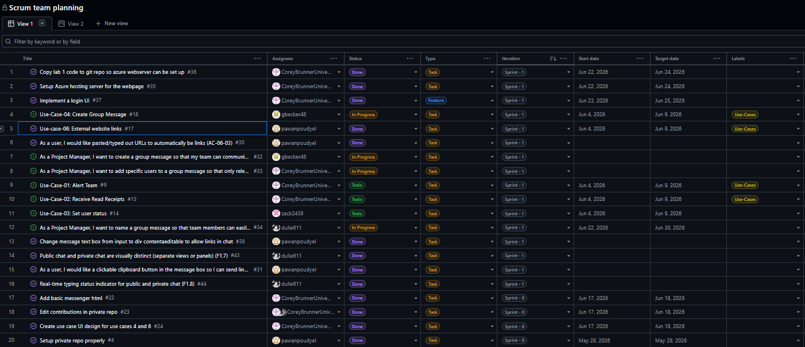

Public chat section board:

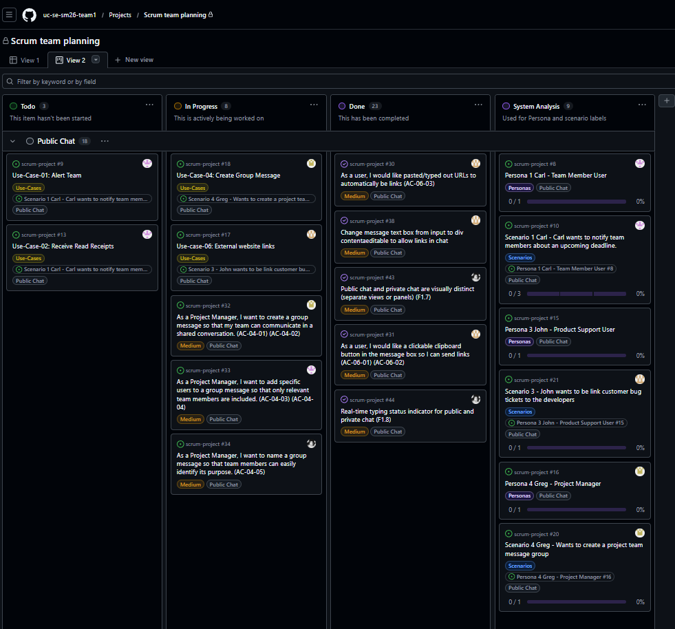

Status setting, Authentication, and No features section:

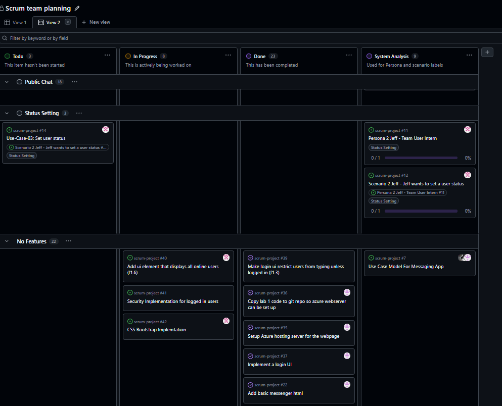

---

Table view of Sprint 2:

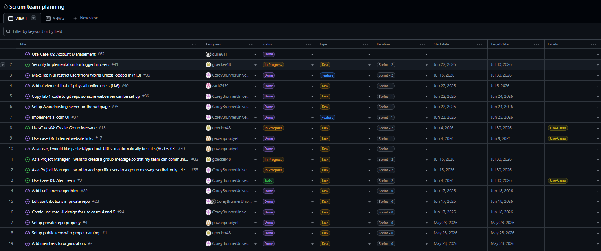

Public chat section board:

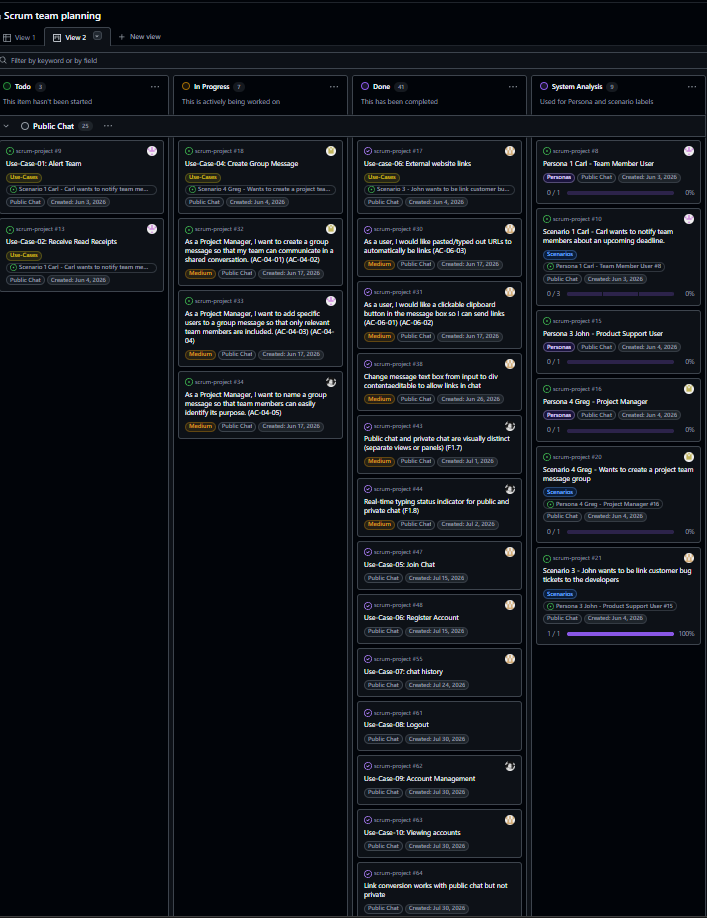

Status setting, Authentication, and No features section:

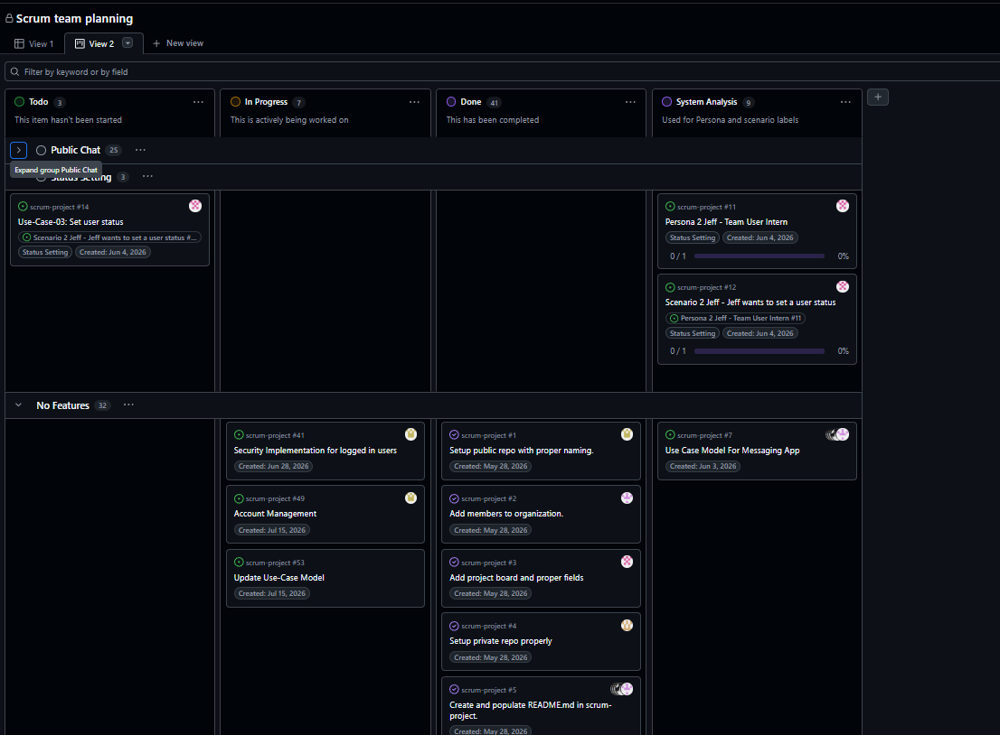

---

## Use Cases

[](https://editor.plantuml.com/uml/LT3FJiCm3CVnUvx2wdq7zcT7j6bNk0ps02RzqKMaQMKxW8HuTzGgICdnAtyYnJwfiLWUeujuDxA990ntepu8l8KfEVOs2NMNAILuGqytXNJ4Ikl4BOxJ447TCrIH1WYTvxcZ7qUK5PuLr9qZnEWLFAvlRvU7Udg5H_W4NS4zhJ6R5hYjuGji2I4rjlnFTZMv2DX0WqnvfX6gFA2uVVEZR7Sa2vwNFOiurE8ff8_b9FWsIE98NtZJOD22Z-wtd6UpULnNgclRrAwfVLE7fexkXDJdCVu1)

| UC ID | Use Case                   | Primary Actor  | Brief Description                                                                                                                                                                         |
| ----- | -------------------------- | -------------- | ----------------------------------------------------------------------------------------------------------------------------------------------------------------------------------------- |
| UC-01 | Alert Team                 | Connected User | Connected User uses the '@(tagline/username)' to alert team members; Connected User clicks 'Send' and all team members are alerted.                                                       |
| UC-02 | Receive Read Receipts      | Connected User | The receiving user reads a group message. The user who sent the message sees through the chat UI that the receiving user has read the message.                                            |
| UC-03 | Set User Status            | Connected User | The system allows the user to select a custom status to display their availability.                                                                                                       |
| UC-04 | Create Group Message       | Connected User | Actor selects “Create Group Chat,” enters group details such as the group name and participants, and submits the request; the system validates the input and creates a new group chat.     |
| UC-05 | Authentication             | Connected User | The user logs into the messaging application by entering their credentials. The system verifies the credentials and either authorizes or rejects the login attempt.                       |
| UC-06 | Links to External Websites | Connected User | Actor pastes a link into the chat. The link is displayed as clickable and opens the external website in a web browser.                                                                     |
| UC-07 | Chat History               | Connected User | The user views previously sent and received chat messages so that earlier conversations remain available after reconnecting or reopening the application.                                 |
| UC-08 | Logout                     | Connected User | The user selects the logout option. The system terminates the user's authenticated session, updates the connected-user list, and returns the user to the login page.                      |
| UC-09 | Account Management         | Connected User | The user views and manages their account information. The user can update their name and password, while their username remains visible but cannot be edited.                             |
| UC-10 | Viewing Accounts           | Connected User | The user selects another user from the user list to view that user's name, username, and email address in a read-only format.                                                              |                                                                                                  |

---

# System Design

_Start in Sprint 1; keep updating._

## Architecture

Describe the architectural style (e.g., layered, client-server, microservices) and the major components. Embed an architecture diagram if it differs from the high-level one in §Overview.

[](https://editor.plantuml.com/uml/NLB1RjD04BtlLunoRXAuHWYrJP0AIg2g8t6eUvZOWxF4dZKxOvSAyU_CndQW72nxFU-zUMzchqKnQjVKJhtM13iI8QueGlzcyHPkOd7qIeLsaM0EwzeJwpAZs1jYG-8hTavEdbkCs40HcZQmGJ9zCR5eHEIg9kTQB4vO4Sm62TZY2yKP_7AFjp4yYwaDXPplzhljSfrboq_OOrP4t-eJeC28Sx__4HkD_1Nx74fQV1TOmeUVRRGiC41C5hciII26Jkrb9y2sXJfKlZZhZmJtc8NYHBhm8US7mdgklY5eh8ILv-gC7I0VloGp9IeUKCpDBd0LDhTmepLApkiwT2Linl8iyKQ4SrFe-VpznUaAxlRxUnlQZuv4JM0Ri8JMWgOyqXqQhv2wNTZl4dtoOlolT1XEjWXc6xuFd7D6AQizjWxo_PI5nBcfzNywzsZ_HXHGRsiHToadx6HWbRwmB53qefhpizUZJVbitPf-inR7rxscIQqWqs0tQsamZTvQGMUwSfNp97TrjcvvR8k2AP6uYVvwUWzajvH1iAToc9ExjkZfRly1)

## Use-Case Realization

For each use case in §Use Cases, describe how it is realized in code: which modules, endpoints, and database collections participate. **Sequence diagrams** are encouraged for non-trivial flows (e.g., authentication, message send/receive). _(Sprint 1 onward.)_

---

Use case 06:

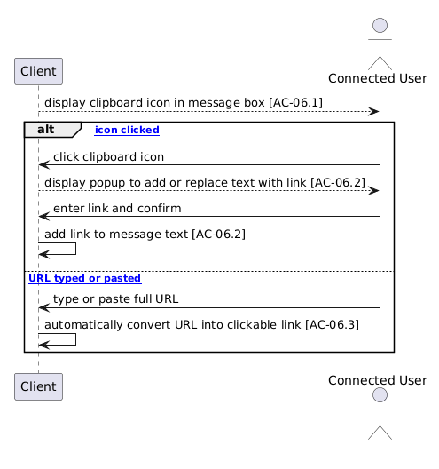

User types or pastes a URL, and `client.js` converts the URL into an `<a href="...">` element. The normal message-sending and receiving protocol is then followed.

Use case 07:

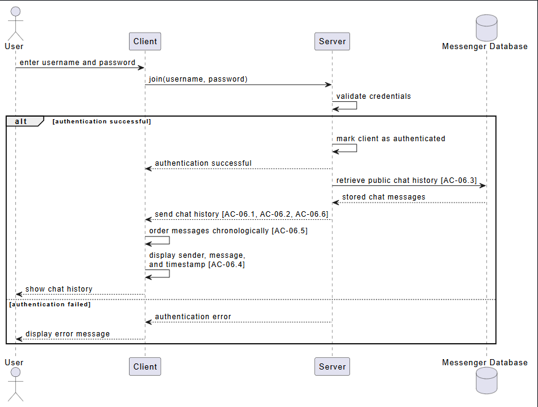

Chat history automatically gets saved to mongodb and is retrieved and loaded automatically when you login into the website
Use case 08:

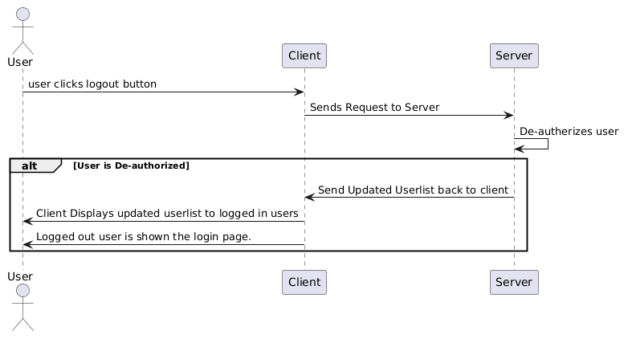

When clicking the logout button the server de-authorizes the user and logs them out

Use case 09:

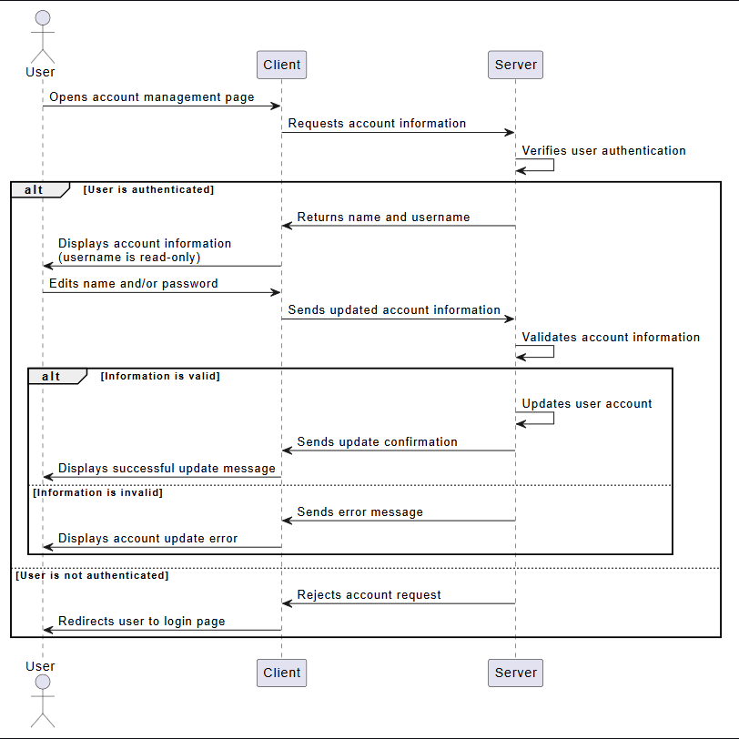

User van click on Account Management to update their password, name, and email

Use case 10:

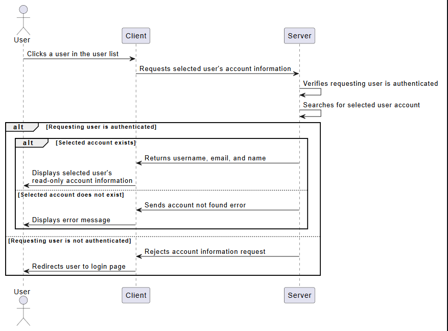

User can click on any user in users list to see the other users contact info

---

## User Interface

Embed UI mockups or screenshots and describe the interaction model. Wireframes are acceptable for Sprint 1; final screenshots for Sprint 3. _(Sprint 1 onward.)_


**Interaction Model:** The user greg is shown a basic UI with some tools and chat history on the left side. One of the tools on the left side is "Create Group". When pressed a UI pop up is shown in the middle that includes `Group Name`, `Add Users` and `Send Message (optional)`. These interactions are needed to create a group. Finally, there are buttons to create group and cancel the creation. If the group is created, the users added and the creator will see a group name pop up on the left hand side. The pop up UI will disappear and if a message was entered in that UI, then it will be sent to the group members.


**Interaction Model:** The user again is greg. The chat message includes two sections, type message and a tool bar. When a user pastes a link and wants to edit it, the user will click the `link icon`. After clicking, the user can see a UI pop up asking what the URL is and what text do they want to display the URL. After clicking `add link`, the link will be added/edited in the message box. The user can also just send raw url's to the group and it will be displayed as a link.

## Database

Describe your **MongoDB Atlas** schema: collections, fields, indexes, and relationships. Include a sample document for each collection. _(Sprint 2 onward; refine in Sprint 3.)_

```json
// Example collection: users
{
  "_id": "ObjectId",
  "username": "string (unique, indexed)",
  "password": "string (bcrypt)",
  "email": "examplee@mail.com",
  "fullName": "Bob Smith"
}
// Example collection: MessageHistory
{
  "_id": "ObjectId",
  "sender": "username",
  "message": "example message",
  "timestamp": "123456",
  "deleted": "true",
}
```

---

# Security (SSDLC)

Our team will apply the Secure Software Development Lifcycle (SSDLC) thoughout the design, implementation, testing, and development of the Messenger application. Security will be considered in every layer of the system like the client UI, server side application logic, real time Socket.io communication, database access, and at the final deployed application.

A concrete security threat for Messenger is Cross-Site Scripting (XSS) at the UI layer. Since users can type and send messages, a malicious user could attempt to send HTML or JavaScript code as a message. If the application displays that message without the proper protection the code could run in another user's browser. That user's browser has no way to know that the code should not be trusted. The user's sensitive and confidential information is at risk.

To reduce this risk, our team will sanitize message content before rendering it in the conversation view of the application. We will also consider using a Content Security Policy (CSP) to restrict which scripts are allowed to run in the browser.

## Security Requirements

List security requirements alongside functional requirements. _(Sprint 0.)_

- **SR-1:** All communication between the client and server must use HTTPS to prevent messages and credentials from being intercepted in transit.
- **SR-2:** User passwords must be hashed using bcrypt before being stored in the database; plaintext passwords must never be saved or logged.
- **SR-3:** All user-submitted message content must be sanitized before being displayed in the chat to prevent Cross-Site Scripting (XSS) attacks.
- **SR-4:** Users must be automatically logged out after 30 minutes of inactivity to prevent unauthorized access from unattended sessions.
- **SR-5:** Group chat creation and membership changes must be validated on the server side; clients must not be trusted to enforce access control on their own.

## Threat Model

Identify assets, trust boundaries, and threats. STRIDE or attack-tree format is acceptable. _(Sprint 0–1.)_

### Trust boundaries

- user connecting to browser client
- Browser client connecting to server
- Server connecting to connected clients
- Links to external websites

| Asset                       | Threat                                                        | Mitigation                                            |
| --------------------------- | ------------------------------------------------------------- | ----------------------------------------------------- |
| User Credentials            | (spoofing) Credential stuffing                                | Rate limiting + bcrypt                                |
| Chat Messages               | (tampering) Code is sent as a message                         | input validation                                      |
| Message History             | (repudiation) User denys sending message                      | Record sent messages with timestamps                  |
| Client-Server Communication | (information disclosure) Message could be intercepted         | Use HTTPS                                             |
| Chat Server                 | (denial of service) User floods server with requests          | Add rate limits                                       |
| User permissions            | (elevation of privilege) normal user gets elevated priveleges | check privileges before allowing any elevated actions |

## Security Review Notes

Summarize findings from your Sprint 2 security review and any remediation taken. _(Sprint 2 onward.)_

---

# Implementation

_Start in Sprint 1; keep updating._

Specify your development approach, languages, frameworks, and runtime. Default stack for this course:

| Layer            | Technology                                            |
| ---------------- | ----------------------------------------------------- |
| Runtime          | Node.js (Azure Cloud Shell for development)           |
| Server framework | Socket.io _(e.g., Express)_                           |
| Database         | MongoDB Atlas                                         |
| Client           | HTML / CSS / JavaScript _(framework optional)_        |
| Version control  | git + GitHub (branches + pull requests + code review) |
| Project mgmt     | GitHub Projects                                       |
| Hosting          | Azure App Services                                    |
| CI/CD            | GitHub Actions                                        |
| ...              | ...                                                   |

For each sprint, add a subsection that summarizes new implementation work. Include code snippets only when they illustrate a non-trivial design decision (not as a substitute for the source code itself).

## Getting Started Locally

```bash
# Clone
git clone git@github.com:TODO/TODO.git
cd TODO

# Install dependencies
npm install

# Configure environment (copy and edit; never commit .env)
cp .env.example .env

# Run
npm start
```

## CI/CD Pipeline

Describe the GitHub Actions workflow(s) under `.github/workflows/`. _(Sprint 1 onward.)_

- **Build & test:** triggered on every push and pull request.
- **Deploy:** triggered on merge to `main`; deploys to Azure App Services.

## Deployment

We have a .env.example file copy that file and name it .env and edit the URL to to your mongoDB URL then you can do `npm start` while in src/ui to deploy locally go to the appropriate URL (found at the top of this README) to run it on azure. Commiting changes automatically redeploys with the changes via github actions, you can manually redeploy by clicking redoly in github actions. 

---

# Testing & Quality Assurance

_Start in Sprint 1; **major** focus in Sprint 3._

## Test Plan

Summarize your testing strategy across unit, integration, and system testing. _(Sprint 2 onward.)_

## Test Coverage

Report current test coverage and how to run the suite locally and in CI.

```bash
npm test
```

## QA Plan

Manual test cases for user-facing flows, with expected vs. actual results. _(Sprint 3.)_

---

# GenAI Usage & Reflection

_Start in Sprint 2; **required** in Sprint 3._

Per the course academic integrity policy, the team must document all AI-assisted work on the team project. **Sprint 3 recommends the team to use a GenAI tool** for the final prototype and to document each substantive prompt.

---

# Software Process Management

_Start in Sprint 0; keep updating._

Describe how your team applies **Scrum**: roles, ceremonies (sprint planning, daily stand-ups, review, retrospective), and tools (GitHub Projects board, GitHub Issues, pull requests).

Include:

- A screenshot of the **GitHub Projects board** (Todo / In Progress / Done) at the end of each sprint.
- A **Roadmap view** screenshot from GitHub Projects, or a timeline produced from issue milestones. _(Note: GitHub Projects has a Roadmap view rather than a true Gantt chart; a Roadmap screenshot satisfies this requirement.)_

## Scrum Process

> Copy the block below for each sprint (Sprint 0, 1, 2, 3).

### Sprint 0

**Duration:** 2026-05-27 to 2026-06-16

#### Sprint Goal

The goal of this sprint is to outline the basic requirements, scenarios, and use cases of our messenger application.

#### Completed PBIs / Tasks

1. Added user stories, scenarios and use cases.
2. Completed acceptance criteria for use cases.
3. Add sequence diagrams for the use cases.
4. Complete sprint retrospective.
5. Create use case UI design for use case 4 and 6.
6. Setup private repo properly.
7. Setup public repo with proper naming.
8. Added members to organization.
9. Created Project board.
10. Added basic messenger html
11. Updated index.html with proper information.

#### Contributions

| Member                    | Hours | Contribution Summary                                                                                                                                                                                                                                                                                                                 |
| ------------------------- | ----- | ------------------------------------------------------------------------------------------------------------------------------------------------------------------------------------------------------------------------------------------------------------------------------------------------------------------------------------ |
| Member 1 - Corey Brunner  | 7     | added Use-cases 1 and 2. Added AC and and sequence diagrams for Use case 1. Futhermore, added basic messenger UI, UI diagrams for use cases 4-6, Managed project board by added comments to team members use cases, created issues, and assigned tasks.                                                                              |
| Member 2 - Pawan Poudyel  | 6     | Added use case 6, added acceptence citeria and sequence diagram for use case 6, added threat model in readme, and created sub issues for all user stories                                                                                                                                                                            |
| Member 3 - Zack Bailey    | 6     | added use case 3 derived from the scenario involving status setting. Added pbis that were relevant to the rubric and module 3. Completed acceptance criteria and sequence diagrams for my use case. Created the sprint retrospective based upon the group consensus of the sprint.                                                   |
| Member 4 - Abdulah Dia    | 6     | Created architecture diagram, updated the the beginning of the security section in README, added 1 more user story, acceptance criteria, and sequence diagram for use case 2                                                                                                                                                         |
| Member 5 - Garrett Becker | 6     | added use case 4 from the scenario involving a project manager wanting to create a group message, added the AC and sequence diagram for use case 4. Added 5 different security requiremments to the README.md, updated all TODO sections of the Security section in the README.md, and updated some of the project board and status. |

#### Sprint Retrospective

| Good         | Could have been better | How to improve                                                         |
| ------------ | ---------------------- | ---------------------------------------------------------------------- |
| Teamwork     | Organization           | Communicate with team to ensure proper organization.                   |
| Coordination | Redundancies           | Establish what the needed things are in order to prevent redundancies. |

- **What went well** — Good teamwork and team coordination. We were mostly able to figure out how to delegate tasks to each member. Our use cases were descriptive and defined the problem well. Acceptance criteria and sequence diagrams were done well and made the use cases easy to quantify.
- **What could have been better** — Our biggest struggle was organization, specifically when utilizing the project board with pbis. Making sure all pbis were properly labeled and in the correct fields was also difficult. We also had some overlapping pbis and use cases that added extra clutter but were not needed.
- **How we will improve next sprint** — Using the fact that we had good team coordination, we will work to improve the project board organization and remove any redundancies that make it unclear what we need to do. We will also make sure to communicate what pbis we are creating so we do not have duplicates.

### Sprint 1

**Duration:** 2026-06-17 to 2026-07-09

#### Sprint Goal

Create and implment a basic messenging web app that lets users pick a username, send/recieve messages, and send external links.

#### Completed PBIs / Tasks

1. [PBI #38 Change message text box from input to div contentaeditable to allow links in chat](https://github.com/uc-se-sm26-team1/scrum-project/issues/38)
2. [PBI #30 As a user, I would like pasted/typed out URLs to automatically be links](https://github.com/uc-se-sm26-team1/scrum-project/issues/30)
3. [PBI #31 As a user, I would like a clickable clipboard button in the message box so I can send links](https://github.com/uc-se-sm26-team1/scrum-project/issues/31)
4. [Public chat and private chat are visually distinct (separate views or panels) (F1.7)](https://github.com/uc-se-sm26-team1/scrum-project/issues/43)
5. [Real-time typing status indicator for public and private chat (F1.8)](https://github.com/uc-se-sm26-team1/scrum-project/issues/44)

#### Contributions

| Member         | Hours | Contribution Summary                                                                                                                                                                                                                                                                                                                             |
| -------------- | ----- | ------------------------------------------------------------------------------------------------------------------------------------------------------------------------------------------------------------------------------------------------------------------------------------------------------------------------------------------------ |
| Corey Brunner  | 6     | Created a web app service to host the web app. Also had to debug and alter the yml file since the package.json file sat inside a directory. I also performed functional requirements 1.1 - 1.3. These requirements handled SPA and user sign on. The code I implemented allowed the user to pick their username and display it in the user list. |
| Pawan Poudyel  | 6     | Did the 3 userstories for `use-case-06` for adding external links support(similar to microsoft teams) and updated overview, system analysis, user stories & product backlog, and user-case realization in README.md                                                                                                                              |
| Zackary Bailey | 6     | Implemented the real-time updating user display list, added the css stylesheet, added pbis to github, completed sprint retrospective.                                                                                                                                                                                                            |
| Abdulah Dia    | 6     | Implemented Functional Requirement F1.7 and F1.8. Created PBIs for each functional requirement.                                                                                                                                                                                                                                                  |
| Garrett Becker | 6     | Did the autoscroll feature for public chat (F1.4) and built out all of private messaging (F1.5) with Socket.io, so users can send direct messages to a specific online user. Also filled out the System Design section of the README and updated our pbis on the project board.                                                                  |

#### Sprint Retrospective

| Good                          | Could have been better | How to improve              |
| ----------------------------- | ---------------------- | --------------------------- |
| Code organization and quality | Scheduling             | Predetermined meeting times |
| distribution of work          | Communication          | More consistent messaging   |
| documentation                 |                        |                             |

Working through the sprints is a continuous-improvement process. The retrospective happens at the end of a sprint, before planning the next one. Cover three things briefly:

- **What went well** — The things that went the best during this sprint was our distribution of work, quality code implementation, and documentation.
- **What could have been better** — The things that we struggled with this most during this sprint was scheduling. We found ourselves waiting longer than needed to schedule making it difficult for schedules to align.
- **How we will improve next sprint** — During the next sprint we will preemptively schedule meetings throughout based upon the times that we are sure we will be available. Having predetermined meetings throughout the sprint will make it more consistent and less likely for scheduling conflicts.

### Sprint 2

**Duration:** 2026-07-15 - 2026-07-30

#### Sprint Goal

Implement quality of life features, refine the user interface, and create a secure messaging environment requiring users to register and login.

#### Completed PBIs / Tasks

1. Security implementation for logged in users
2. Make login ui restrict users from typing unless logged in
3. UseCase-04 Join chat
4. UseCase-06 Register account
5. Account Management
6. MongoDB setup
7. Account login security
8. Finding Users
9. Chat history
10. Add functionality to delete messages from chatroom
11. UI Updates and Cleanup
12. Add MONGO_URI environment in Azure
13. Use-case-07 through 10 

#### Contributions

| Member   | Hours | Contribution Summary |
| -------- | ----- | -------------------- |
| Corey Brunner | 6     | Set up MongoDB, Azure staging environment, SPA for account management, created pbis and updated use case diagram. Lastly, added bootstrap login/registration                 |
| Pawan Poudyel | 6     | Implmented logging in and registering a user, seeing other users's info, fixed private chat URLs not working, creates PBIs and diagrams, and updated readme                 |
| Member 3 | X     | TODO                 |
| Member 4 | X     | TODO                 |
| Garrett Becker | 6     | Secured the MongoDB connection with environment variables, built out account management (change password, email, and full name), added user logout functionality, created PBIs, and updated the README.                 |

#### Sprint Retrospective

| Good | Could have been better | How to improve |
| ---- | ---------------------- | -------------- |
|   Feature Implementation   |          Work distribution              |       Figure out what specific features need to be done in what order.         |
|   CICD Development   |          Scheduling              |      Emphasis communication within the team to establish more routine meetings.          |

Working through the sprints is a continuous-improvement process. The retrospective happens at the end of a sprint, before planning the next one. Cover three things briefly:

- **What went well** — The actual implementation of the various features was relatively smooth, and also we felt that we utilized the CICD method with azure by using the staging environment to test outgoing changes.
- **What could have been better** — The most difficult part was distribution of work and figuring out scheduling. The sprint had a lot of different features to implement and that made it harder to focus on what needed to get done.
- **How we will improve next sprint** — Be more organized with the scheduling, communication and distribution of work. Figure out what the order the features need to be added in first.


# User Guide / Demo

_Start in Sprint 1; finalize in Sprint 3._

Write this section as both a **demo** (with screenshots of the running application) and a **how-to** for a first-time user. Cover sign-up, login, and the main user flows.

[Link to demo](https://youtu.be/43h718RuYJ0?si=XLGs0Wch_xDvC42u&t=399)

---

# License & Code of Conduct

This project is developed for academic purposes as part of EECE/CS-3093C at the University of Cincinnati. The team follows the **ACM/IEEE Software Engineering Code of Ethics** (https://www.acm.org/code-of-ethics).

If your team chooses to publish the repository after the course, add an explicit license (e.g., MIT) here and a `LICENSE` file at the repo root.

---

Last template revision: 2026-07-09
